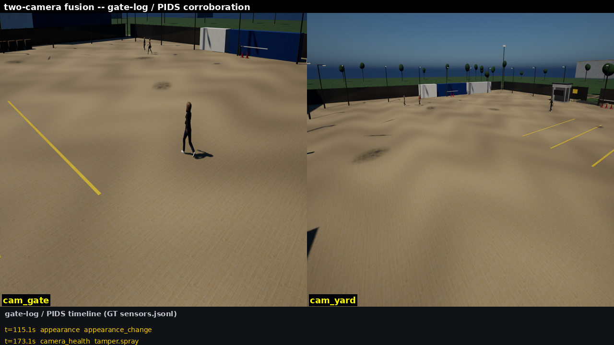
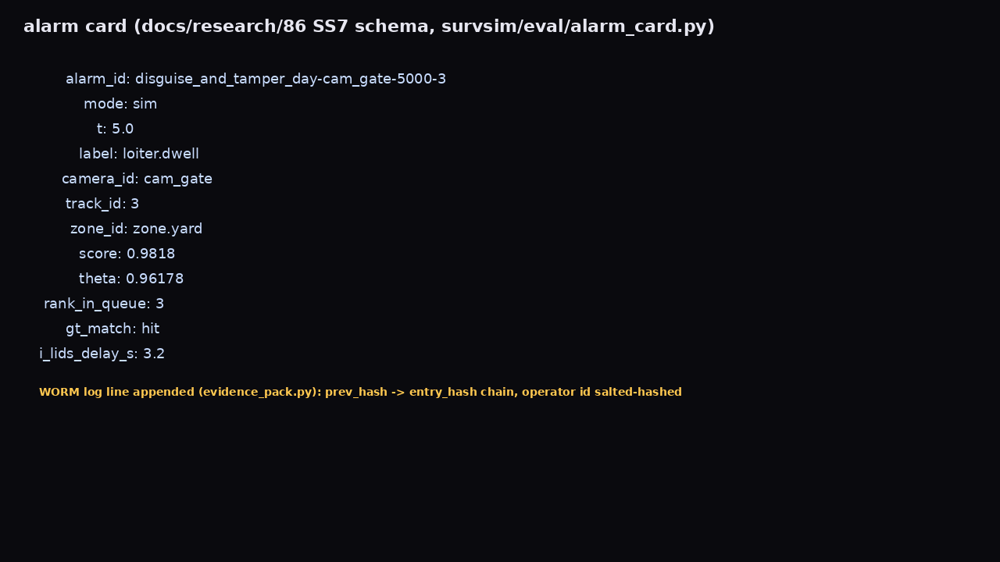
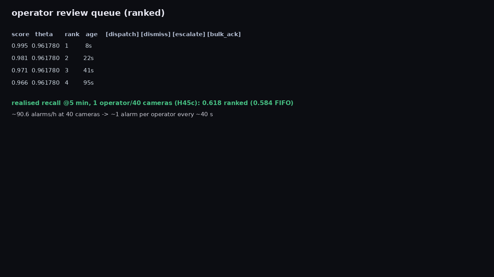
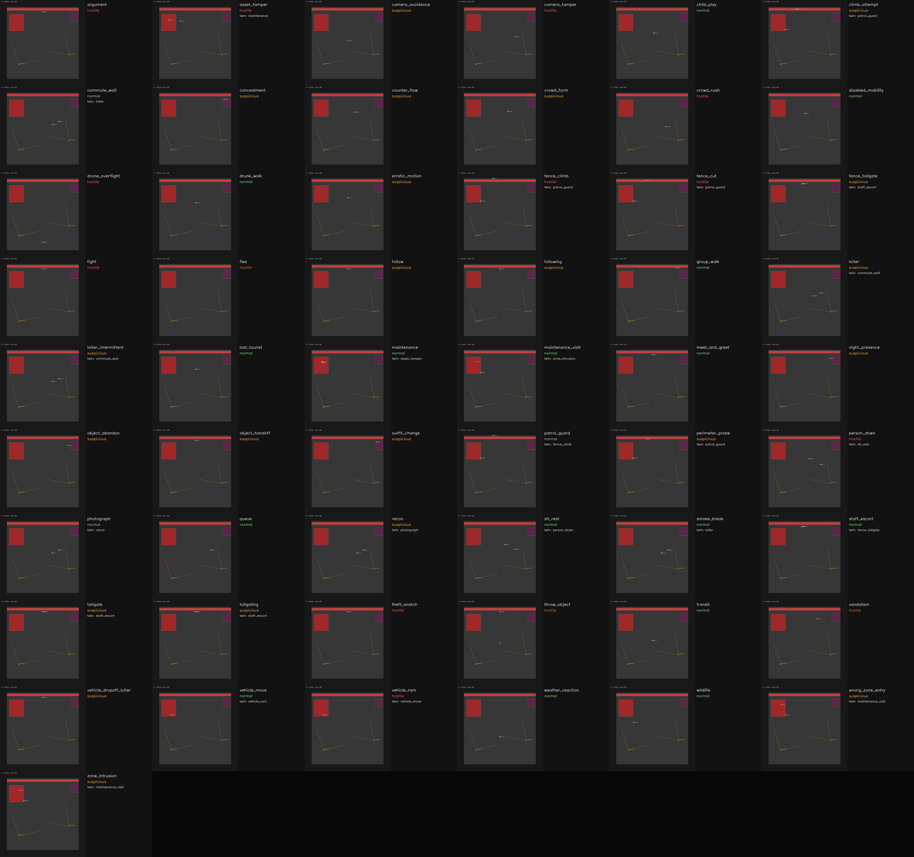
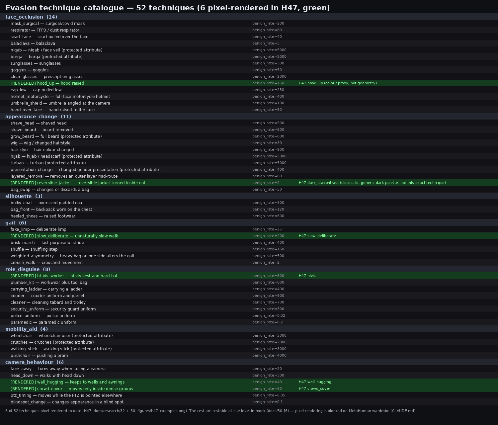
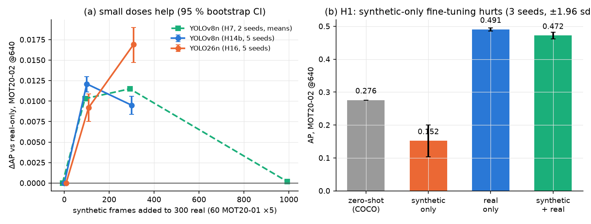
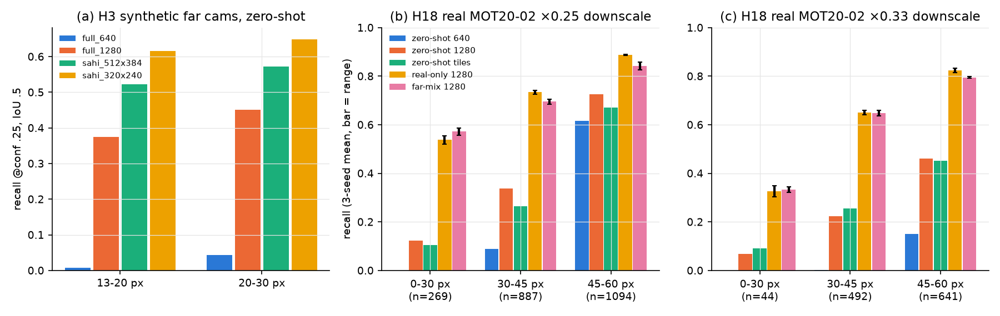
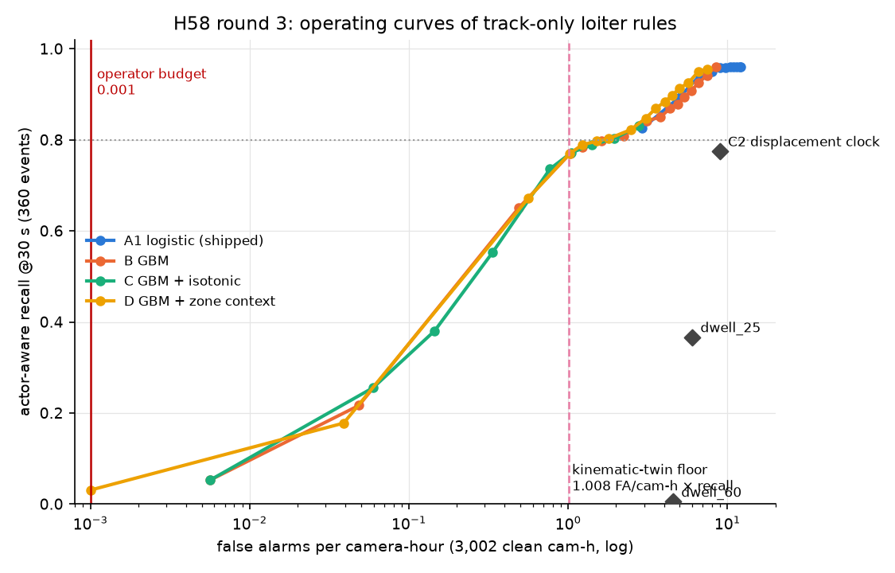

# cctv-security

CCTV security analytics built on the **cctv-security-simulation** (`survsim`) simulator:
alarm evaluation in operational terms, tracking and detection baselines, a config-driven
experiments framework, and the research notes behind them.

Principles: report **false alarms per camera-hour** and i-LIDS-style timing rather than
frame-level AUC; an alarm on the wrong person is not a hit; hard negatives matter as much
as positives; every experiment is seeded.

## Samples

Sensor fusion, alarm evidence cards and the operator queue:





Behaviour and evasion catalogues exercised by the evaluation:




Experiment results (dose-response of degradation, far-field recall, loiter operating curves):





## Quick start
```bash
python3.11 -m venv .venv && source .venv/bin/activate
pip install -e ".[dev]"      # pulls survsim from the private cctv-security-simulation repo
pytest -q -n auto
survsim run configs/scenarios/smoke_mock.yaml --out out/run
cctvsec eval out/run --threshold-s 25      # alarms per camera-hour
cctvsec experiment <name>                  # see cctvsec/experiments/configs
```

## Layout
| Path | Content |
|---|---|
| `cctvsec/eval` | alarm scoring, tracking/detection metrics, fusion, retrieval, TrackEval bridge |
| `cctvsec/baselines`, `models` | ByteTrack/YOLO baselines, detector wrappers |
| `cctvsec/experiments` | seeded experiment runners and configs |
| `cctvsec/gait`, `checks` | gait extraction, box-tightness check |
| `docs/research` | research dossiers, audits and verified-facts ledger |
| `configs/` | copy of the simulator's scenario configs used by experiments |
