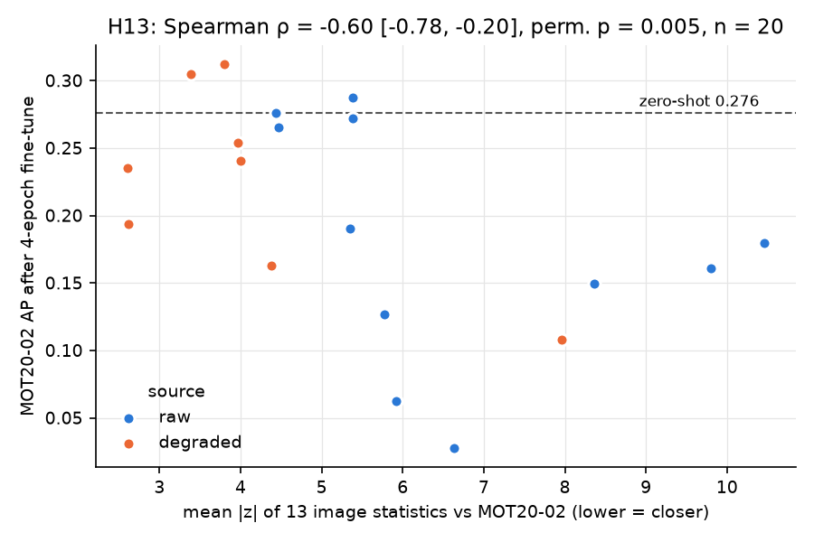
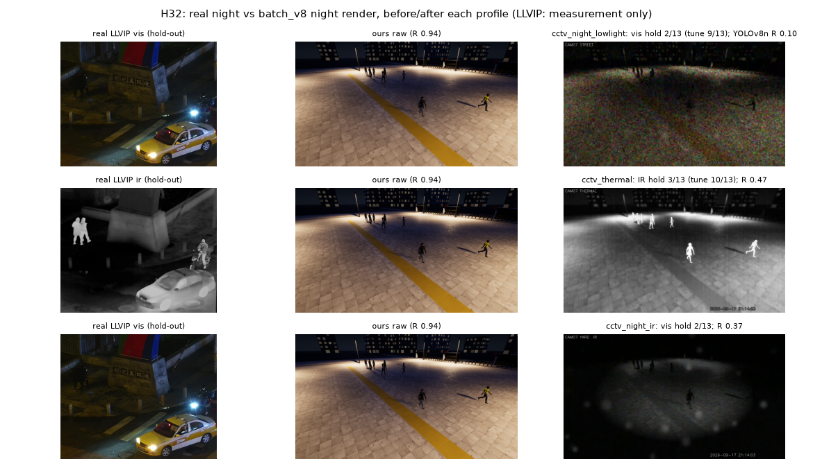
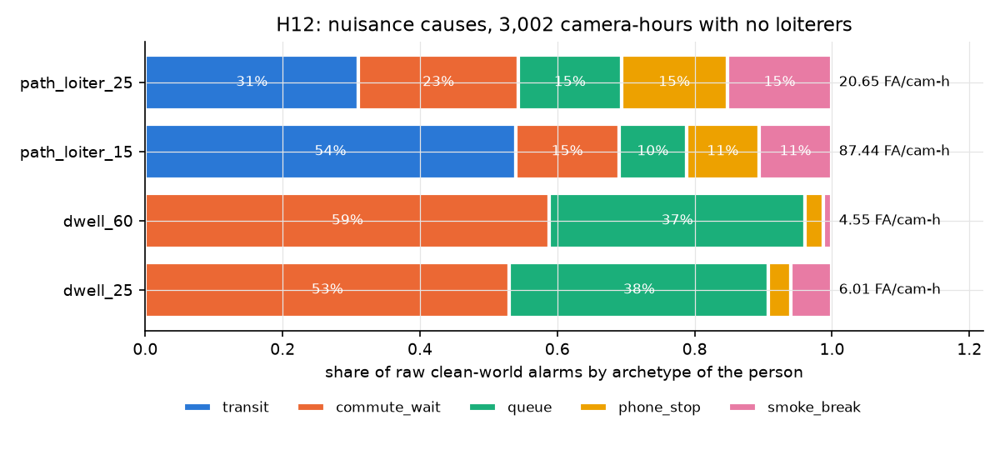
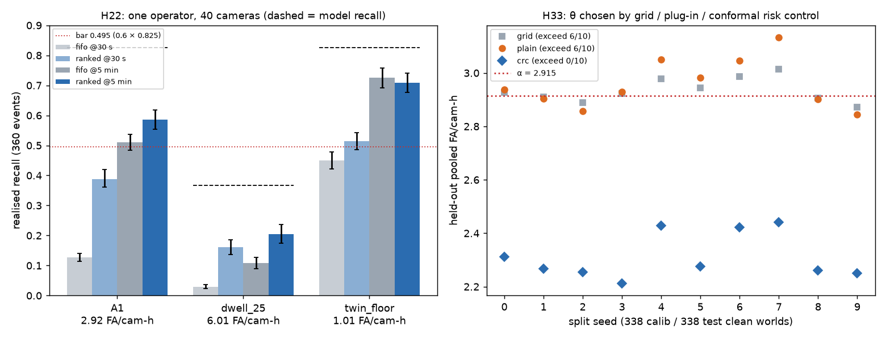

# 64 · Small Doses, Wrong Pixels, and Unreachable Budgets: Pre-registered Sim-to-Real and Alarm Experiments with a CCTV Simulator

*Technical report, SurvSim project, 2026-09-27. Self-contained; written in arXiv
form. Every number below is copied from a results file under
`out/experiments/` or from the experiments log (`docs/research/32`) and the
loiter-redesign report (`docs/research/58`). The commit that introduced each
result is given in brackets like this: [`851fdd3`]. The figures come from
those JSON files. They were drawn by a CPU-only matplotlib script, which is
not committed; its logic is summarised in Appendix A.*

---

## Abstract

We describe SurvSim, a multi-camera, multi-person surveillance simulator that
comes with complete ground truth (identity across cameras and clothing
changes, behaviour labels with timings, and which camera observed each act).
We then report twenty hypothesis-driven experiments (H1–H20) plus a
three-round redesign of a loitering rule (H58). Most of them were
pre-registered and committed before any number was produced. The experiments
fall into four groups. (i) **Synthetic→real person detection.** On real MOT20
footage, fine-tuning a COCO-pretrained YOLOv8n on our renders alone *lowers*
AP from 0.276 to 0.152 ± 0.025 (3 seeds). Adding a *small* dose of synthetic
frames to 60 real frames raises AP by only **+0.004–0.005 at equal optimiser
steps** (H51: +0.0042 at 100, +0.0051 at 300 frames, 10 paired seeds, Holm
p 0.0039 both; H26's 5 seeds had found the same size without clearing Holm). The earlier +0.0121 [0.0111, 0.0130] / +0.0095
(h14b, Holm-rejected) compared unequal steps: the real-only arm trained ~228
iterations, the mix arms 300–450, and real-only alone gains +0.0049 at H26's 450-step recipe (which also
lengthens warm-up and keeps mosaic on; AUDIT_H51).
The unequal-step gain replicates on YOLO26n (+0.0092 / +0.0169) and passes
into tracking weakly (HOTA +0.0103 [0.0008, 0.0197], pre-parity scorer); neither has been re-run at equal steps. (ii) **Labels and realism.** Over 20 synthetic training sources,
image-statistics distance to the real target predicts transfer (Spearman
**ρ = −0.60** [−0.78, −0.20], permutation p = 0.005). Tight mask labels and
amodal labels change AP by at most 0.002. (iii) **Tracking and ReID.** Far
cameras cost 0.17 HOTA. Night alone costs no measurable HOTA; the simulated
IR degradation blinds the detector. On our renders a colour histogram
matches ImageNet OSNet, and both collapse across an outfit change.
(iv) **Alarm rules at scale.** On 3,002 camera-hours of worlds that contain
no loiterer, every shipped loiter rule produces 4.55–87.4 false alarms per
camera-hour (FA/cam-h), against an assumed operator budget of 0.001 (28 §6). A learned
track-only rule ships at 2.9 FA/cam-h (recall 0.825). We show a
generator-defined floor of about 1 FA/cam-h: smoke breaks at gates are
kinematic twins of loiters, so no track-only rule can go below it. We state
three claims we can defend, the limits on each, and the evidence that
publication would need: more real sites and licence-clean real data.

---

## 1. Introduction

Real CCTV cannot tell you who a person is across cameras, when an act of
reconnaissance began, whether it was visible, or whether a camera was
tampered with. A simulator can. Its value to an analytics team rests on two
empirical questions:

1. **Does its imagery help or hurt a real detector?** It can be used as
   training data or as a proxy test set.
2. **Do the operational conclusions it produces (alarm rates, blind spots,
   failure modes) mean anything?** They cannot be measured on real footage at
   the same scale.

The public literature answers the first question optimistically for
large, purpose-built synthetic sets such as MOTSynth [1] and PeopleSansPeople
[5]. Those sets are 10⁴–10⁶ images, built by teams, and evaluated with mature
recipes. A small team with an 8 GB laptop GPU and a few thousand rendered
frames is in a different regime, and the published curves do not say what
happens there. The second question is seldom asked at all. Detection papers
report AP. Security buyers count false alarms per camera-hour against a
budget, and under the UK i-LIDS protocol an alarm that arrives late counts as
a false alarm [FACTS_VERIFIED #20].

This report makes three contributions:

* **A pre-registered experimental record.** Eighteen detection, tracking,
  ReID and alarm hypotheses plus a three-round rule redesign. Hypothesis,
  metric, arms, seeds, analysis and decision rule were committed before the
  runs (from H9 onwards; H1–H8 were exploratory). Negative results are
  reported as fully as positive ones.
* **A dose-response account of small-scale sim2real.** Synthetic-only
  training hurts; small doses help reliably but only a little; large doses
  and synthetic pre-training erase the gain. We also give a cheap
  image-statistics screen that ranks synthetic sources by how well they
  transfer.
* **A measured impossibility result for track-only loitering rules.** The
  simulator's own hard negatives set a false-alarm floor about 1,000× above
  an operator budget. The best rules we built sit about 3× above that floor.

---

## 2. Related work

All sources below were fetched and read when the underlying dossiers were
written (docs/research/24 and 30, fetched 2026-09-26; MOT20/ByteTrack/i-LIDS
facts in `FACTS_VERIFIED.md`). The numbers quoted are the papers' own.

**Synthetic pedestrians for detection and tracking.** MOTSynth [1] (ICCV
2021; arXiv 2108.09518) rendered GTA-V crowds. Pre-training on them raised
MOT20 detection AP from 42.42 to 53.69 (YOLOv3) and from 43.67 to 53.90
(Faster R-CNN). The gain on the less crowded MOT17 was only about 2 AP. In
other words, synthetic data helps most where real labels are hardest to
produce. PeopleSansPeople [5] (arXiv 2112.09290) gives the clearest
data-scaling curve. Synthetic pre-training lifts COCO person AP from 13.82 to
42.58 when only 1 % of the real data is available (641 images), but only from
56.73 to 57.44 with all of it. Its recipe is pre-train on synthetic, then
fine-tune on real. Older work includes JTA [3], Marín et al.'s virtual
pedestrians [14], scene-specific detectors trained without real data [13],
and Driving in the Matrix [15]. That last one showed a detector trained only
on 200k game frames beating one trained on 2,975 real Cityscapes images on
KITTI (0.6803 vs 0.6247 AP, easy).

**Domain randomisation vs photorealism.** Tobin et al. [DR-1] (arXiv
1703.06907) and Tremblay et al. [DR-2] (arXiv 1804.06516) showed that
randomised non-photoreal imagery can transfer. Tremblay's VKITTI vs DR
table and freezing ablation (66.4 vs 78.1 AP) are the direct precedent for
our H6 backbone-freeze arm. Structured DR [DR-3] (arXiv 1810.10093) found
that small objects need scene context. Hinterstoisser et al. [DR-5] (arXiv
1710.10710) argued for freezing real-pretrained features and training later
layers on renders. We test that idea in H6 and find it roughly halves the
loss but does not remove it.

**Measuring the gap.** FID [DR-6] (arXiv 1706.08500) is biased, and the bias
depends on the model [DR-8] (arXiv 1911.07023). KID [DR-7] (arXiv 1801.01401)
is unbiased. Inception features encode ImageNet class content rather than
sensor statistics [DR-9] (arXiv 2203.06026), and aliased resizing and JPEG
distort the score [DR-13] (arXiv 2104.11222). Precision/recall splits
fidelity from coverage [DR-10] (arXiv 1904.06991). We use a deliberately
low-level alternative: 13 frame statistics (noise σ, Laplacian variance, MTF
ratio, edge width, luma, contrast, chroma, …). Each isolates one physical
cause and needs no neural embedding. The sensor-noise model behind our
degradation chain follows Foi et al.'s Poisson–Gaussian formulation [DR-16]
and the unprocessing pipeline of Brooks et al. [DR-17] (arXiv 1811.11127).

**Synthetic ReID.** SOMAset [4], PersonX [8], RandPerson [9], UnrealPerson
[10] and ClonedPerson [11] report Market-1501 direct-transfer rank-1 rising
from 55.6 to 84.5. Under one recipe (QAConv 2.0, ClonedPerson Table 4) that
spread mostly closes, to 80.6–84.5, so most of the jump comes from the
recipe, not the data. The Alice benchmarks [12] (ICLR 2024, arXiv 2310.04416)
exist because synthetic→real ReID still needs adaptation. Clothes-change ReID
in synthetic video [20] is the closest analogue to our appearance epochs.

**Tracking and evaluation.** MOT20 [MOT20] (arXiv 2003.09003) averages about
127 people per frame (peak 246), annotates amodal boxes with a visibility
ratio, and applies no visibility cut in its own evaluation. ByteTrack
[BYTE] (arXiv 2110.06864) reports 80.3 MOTA / 77.3 IDF1 / 63.1 HOTA on MOT17
and is our tracker baseline. HOTA splits tracking quality into detection
accuracy (DetA) and association accuracy (AssA); our implementation is
validated against its definition and on real MOT20 footage (docs/13).
**Alarm evaluation.** The i-LIDS user guide uses a 10 s alarm window and
disregards repeat alarms [FACTS_VERIFIED #20]. We report both i-LIDS-style
scoring and a stricter default. Garwood exact Poisson intervals and the rule
of three for zero-event soaks follow docs/research/49 §5.

**What none of these covers.** Degraded CCTV at 20–60 px, operator-budget
false-alarm rates for behaviour rules, and a small-data regime where only a
few hundred synthetic frames exist. Those three gaps define this report.

---

## 3. Method

### 3.1 The simulator

SurvSim is split at an engine boundary (docs/research/52 §2).

* **Director.** Written in Python and independent of any engine. It owns
  time, people, 44 behaviour classes covering 49 catalogue names, appearance
  epochs, crowd avoidance, and a camera director (PTZ plus 6 tamper kinds).
  It works in SI units, and each subsystem has its own seeded RNG
  (`RngHub`), so the same seed gives the same run.
* **Backend.** It renders what the Director decides. The `mock` backend is
  pure Python, top-down and needs no GPU; it is used for every alarm study.
  The `unreal` backend drives the Unreal Engine 5.8.2 editor headless under
  `xvfb-run` (SceneCapture2D) and derives boxes from per-person
  instance-mask passes.
* **Recorder.** Writes MOT text files, `world.parquet` (actual post-avoidance
  agent state), `events.jsonl`, `identities.parquet`, calibration and
  `licences.json`.
* **Degrade chain** (`sensors/degrade.py`). Poisson–Gaussian noise, auto
  exposure, an IR illuminator model and one ffmpeg H.264 GOP round trip,
  bundled as profiles `cctv_day_720p` and `cctv_night_ir` (docs/15).

Three design rules matter for the experiments. Truth is recorded as what
happened, not what was planned. Every suspicious behaviour has an innocent
look-alike (`commute_wait` vs `loiter`, `smoke_break` vs pacing loiter). And
there is one definition of "visible": in frame, in front of the camera, and
at least 20 px tall.

### 3.2 Data

| set | cast / licence | content | used in |
|---|---|---|---|
| `batch_v5`, `batch_v6` | MetaHuman (internal evidence only, §7.1) | 8 runs, 300 frames per camera; disguise_and_tamper, smoke_mock, street_crowd, street_crowd_far; day and night | H1–H8, H13 |
| `batch_v7` | 16 CC0 Quaternius bodies, `commercial_ml_ok: true` | same scenarios, 24 camera sequences, 7,200 frames; mixed 1920/1280 widths; **every body 1.70 m** (height bug fixed at `92e1e97`) | H9–H11, H13, H14, H16 |
| `*_tightgt` (v7) | CC0 | smoke_mock_day and street_crowd_day with mask-derived boxes | H14 secondary, H15 secondary |
| `batch_v8` | CC0 | 9 sets, 10,000 frames; visible (mask) and amodal GT; height gate PASS on all 9 (0 people off by > 2 cm); box-tightness median IoU against a detector 0.876–0.932 | H15, H18 |
| mock worlds | none | scene generator, 6 site types, 676 clean worlds (3,002 cam-h) + 300 recall worlds (360 loiter events), with a disjoint training split | H12, H58 |
| MOT20-01/02/05 | CC BY-NC-SA 3.0, **evaluation only** | first 300 frames of 01/02; 05 as a dark street | all real-pixel evaluations |

Real training frames are always MOT20-01 frames 1–60, repeated ×5. Evaluation
is always on MOT20-02 (the leak-free held-out sequence), except for no-real
arms scored on the 01+02 subset and H11 on MOT20-05.

### 3.3 Protocol and statistics

The template is docs/research/49 §12. Each entry fixes, before any run: id,
hypothesis, primary metric, arms, held-fixed settings, seeds, sample size,
analysis, success criterion, stopping rule, confounds and abandon condition.
Each is committed to `docs/research/32` or `58` before the runner is
launched. Conventions:

* **Seeds are the unit for training effects.** The seed changes both the
  training randomness and which synthetic frames are sampled. Unpaired
  contrasts use the exact two-sided permutation test (5 vs 5 gives C(10,5) =
  252 splits, so the minimum p is 2/252 = 0.0079) and a percentile bootstrap
  CI of the mean difference. Paired contrasts use an exact sign-flip test,
  whose minimum p is 0.0625 at n = 5, 0.016 at n = 7 and 0.25 at n = 3; at
  those sizes the CI carries the evidence.
* **Holm** correction is applied across the co-primary contrasts in an entry.
* **False-alarm rates** use Garwood exact 95 % intervals on the Poisson count
  per camera-hour, plus a world-cluster bootstrap, because alarms cluster by
  world (49 §5). **Recall** uses a world bootstrap (2,000 resamples).
* **Default scoring over i-LIDS-compatible scoring.** Default scoring counts
  every repeat alarm as a false alarm; i-LIDS mode coalesces alarms less than
  5 s apart. From H58 round 2 on, recall is **actor-aware**: an alarm counts
  as a hit only if it fires on a person who is an actor of the event.
* **No selection on the test set.** Detection uses `last.pt` (no checkpoint
  picked on real data). The loiter redesign selects every hyper-parameter on
  a disjoint train split and scores the H12 worlds once.

Hardware: one RTX 2070 Max-Q (8 GB), shared with an idle Unreal editor.
Timings are affected by that; accuracies are not (49 §11).

---

## 4. Experiments

Table 1 is the register. Sections 4.1–4.4 give each group's design and
results, and §5 pulls them together.

**How to read the sim-to-real rows (post-H26; the same story as 52 §5b).** Used as a
replacement for real data, synthetic data hurts: H1 goes from 0.276 to 0.152, and H19's
far-range synthetic-only model scores 0.000 until 60 real frames are added. Used as an
add-on at equal optimiser steps, it gives +0.004–0.005 AP at 100–300 frames, which is
Holm-significant at 10 paired seeds (H51) but ~1 % relative, and 0 at 1,000 (H26). The earlier
h14b gain mixed in extra training steps and is retracted as a headline (R51). What the
simulator reliably provides is evaluation: mask-derived ground truth (batch_v8), generated
hard negatives (H40b), measured rule variance (H21/H23/H42). Forensic-search evaluation
(H37, pre-registered) has no number yet; evasion (H47) now does (next paragraph). It does not yet help with night realism (H32), ReID
transfer (H20) or association through synthetic data (H17, unequal-step arms; an appearance
model does help, H24).

**Evasion (H47, `6d7f5f1`, AUDIT_H47).** Of six renderable evasion techniques only
crowd-blending beats the detector: YOLO26n recall falls by 0.201 [0.154, 0.254] (bootstrap
over the 4 seed × camera clips; every clip ≥ 0.136). Clothing colour (dark, hi-vis) and hood
colour (a dark head colour, not hood geometry) do nothing at 720p daytime (|Δ| ≤ 0.003).
Wall-hugging costs 0.054 in recall but works mainly by shrinking the target under 20 px —
43 % fewer usable person-frames — i.e. it beats the camera geometry, not the model, and a
recall number conditioned on visibility never shows it. Umbrella, carried object,
crouch/crawl and face-away are untested (no CC0 asset or clip), as are night and dark
backgrounds. Hypothesis (≥ 3 of 6) not met.

**Table 1. Hypothesis register.**

| id | question | registered | verdict | key number |
|---|---|---|---|---|
| H1 | does synthetic-only fine-tuning change real AP? | no | **hurts**; synthetic + real < real alone | 0.276 → 0.152 ± 0.025 |
| H2 | does degradation help transfer? | no | helps, still below zero-shot | 0.093 → 0.188 (zero-shot 0.281) |
| H3 | far-field on synthetic pixels | no | 640 px input is blind; 1280 px and tiling recover | recall 0.021 → 0.405 → 0.629 |
| H4 | ReID on renders | no | HSV histogram ≥ OSNet-ImageNet | cross-cam mAP 0.219 vs 0.148 |
| H5 | alarm scoring on 0.35 cam-h | no | superseded by H12 | 11–143 FA/cam-h |
| H6 | why synthetic hurts | no | labels + feature drift + pixels | freeze halves the loss |
| H7 | mixing ratio | no | small doses +0.010; 1,000 frames and pre-training erase it | non-monotonic |
| H8 | far-field fine-tune on real small people | no | **destroys** it (one street, synthetic only) | AP50 0.478 → 0.004 |
| H9 | tracking far/near, night/day; ByteTrack fix | `741b025` | far −0.171 HOTA; night n.s.; fix not adopted | [−0.251, −0.086] |
| H10/H10b | ReID across an outfit change | `741b025` / `fd775af` | v1 not measurable; v2 both appearance cues collapse (n = 1 changer) | rank-1 0.083 |
| H11 | night | `741b025` | night alone −0.02 recall; IR degrade −0.61; night fine-tune hurts | [−0.710, −0.519] |
| H12 | loiter FA at scale | `98b7c03` | all rules 4,500–87,000× over our assumed budget | 4.55–87.4 FA/cam-h |
| H13 | realism distance vs transfer | `98b7c03` (exploratory) | **predicts** | ρ −0.60 [−0.78, −0.20] |
| H14/H14b | small dose replicated, 5 seeds | `98b7c03` / `a9cb181` | **confirmed at unequal steps; equal-step +0.004–0.005 (H26 n.s. at 5 seeds; H51 Holm p 0.0039 at 10)** | +0.0121 [0.0111, 0.0130] (unequal steps) |
| H15 | amodal vs visible labels | `a9cb181`, amended `281535f` | no effect | −0.0005 [−0.0012, +0.0001] |
| H16 | re-baseline on YOLO26n | `a9cb181` | dose gain holds; weaker base | +0.0092 / +0.0169 (unequal steps, as h14b; no equal-step run) |
| H17 | does the dose gain reach tracking? | `79e527e` | supported, weakly | HOTA +0.0103 [0.0008, 0.0197] (pre-parity scorer, not recomputed; unequal-step arms, H26) |
| H18 | far-field v2 (v8, mixed with real) | `79e527e` | no measurable effect; H8's harm gone | +0.0099 (640) / −0.0014 (1280) |
| H19 | far-field v3: which fix removed H8's collapse? | `11f81d2` | **the real mix**: synthetic-only 0.000 on v6 and v8, all seeds; +60 real → 0.817 | +0.817 [+0.812, +0.824] |
| H20 | synthetic ReID fine-tune (15 ids) | `11f81d2` | in-domain +0.324 mAP; real MOT20 no measurable effect | +0.021 [−0.047, +0.097] |
| H24 | ReID appearance in ByteTrack association | `4095a4c` (results `2fdecd6`; AUDIT_H24) | not met (bar +0.02 missed by 0.0006); gain on both sets, association not detection | batch_v8 ΔAssA +0.0194 [+0.0004, +0.0439]; MOT20-02 +0.0139 [+0.0018, +0.0268], IDSW −5.6 |
| H25 | label noise on synthetic boxes (σ 0–10 %, drop 0/10 %) | `c1100bb` (pre-reg in 32) | refuted: gain insensitive to label noise (screening, n = 3) | σ 10 % keeps 97 %; worst cell −0.0008 [−0.0010, −0.0006] |
| H22 | operator review queue (FIFO vs ranked) | `1d8cd26` | inconclusive vs 0.6 bar; ranked beats FIFO at 30 s for every rule (Fig. 6a) | A1/FIFO 0.511 [0.484, 0.537] @5 min; ranked +0.262 @30 s |
| H33 | conformal θ for the FA budget | `4da4eef` | supported: CRC 0/10 exceed vs plug-in 6/10 at α 2.915; 0.001 uncertifiable (floor ≥ 0.248) (Fig. 6b) | recall −0.035 [−0.037, −0.033] |
| H32 | night profiles vs real LLVIP; recall under each | `f3353a2` | not met: tune 9/13 vis, 10/13 IR → hold-out 2/13, 3/13 (overfit); branch B3, so no recall is a night-penalty estimate; P1 refuted, P2 holds (Fig. 7) | YOLOv8n Δ vs raw: NIR −0.565 [−0.660, −0.496], lowlight −0.835, thermal −0.470 |
| H40 | sterile-zone line-cross rule (4 cumulative arms, assumed tracker noise) | `2323de7` (pre-reg `02b51ae`; AUDIT_76_H40) | not met: FA ÷ 16.9 [15.3, 18.6] but recall@10 0.945 → 0.100; every arm > 4,000× budget; optimistic for a real fence | C 4.20 [3.84, 4.57] FA/cam-h |
| H40b | line-cross on fenced worlds with crossing intruders, twins, wildlife (assumed tracker noise) | `12b6c92` (pre-reg `d51e5f9`; AUDIT_H40B) | not met: C clean FA 0 (≤ 0.001, rule of three) but recall@10 0.782 [0.736, 0.829]; residual = twins ≈ 490× budget | C twins patrol 0.389 / maint 0.099 FA/cam-h |
| H47 | six renderable evasion techniques vs zero-shot person recall (hood = colour proxy; props/crawl/face-away untested) | `6d7f5f1` (pre-reg `f4a1cdf`; AUDIT_H47) | not met: 1/6 ≥ 0.10 (crowd_cover) | crowd ΔR −0.201 [−0.254, −0.154] (clip-cluster); wall −0.054, −43 % exposure |
| H53 | late fusion of arm C with simulated gate log, RF tag, PIDS (assumed parameters; true-position matching) | `0c492ba` (pre-reg `6766666`; AUDIT_H53) | not met on recall: twin FA 0.488 → 0.0047 (99.0 % removed) but recall@10 0.782 → 0.758 (bar: no loss) | tailgate recall 0.007; stolen tag 0.701 |
| H54 | H53 fusion with generated fence tailgater + staff-escort twin; estimated-position matching; simulated gate people counter (assumed parameters) | `6e6993f` (pre-reg `137a338`; AUDIT_H54) | met: est C+abc 99.1 % [98.6, 99.5] removed, recall 0.782 → 0.772; tailgater 0.685 [0.589, 0.778] only with the gate counter | est ≈ true under a no-IDSW noise model (upper bound); counter costs removal 99.1 → 96.3 %; H59: under H24-calibrated ID switches the actor-aware score for this fix drops to 0.10, a scoring artefact (swapped label), not a fusion break |
| H56 | PTZ slew-to-alarm, 1 / 2 PTZs, H39 vs exact calibration (mock geometry; all PTZ timings assumed) | `0f05f04` (pre-reg `c0f0ed2`; AUDIT_83_H56) | not met: > 30 m acquire@3s 0.727 [0.706, 0.747] (bar ≤ 0.6); ≤ 20 m 0.901 on point estimate only; contention met | missed second alarm 0.369 (1 PTZ) vs 0.057 (2) |
| H39 | known-height auto-calibration from boxes | `2bdb46b` (pre-reg in 32; AUDIT_75_H39) | not met: free-f 57.4 m RMSE < 20 m vs 0.5 m bar; exact floor 0.21 m; datasheet f 0.96 m post hoc |
| H38 | FP16 / INT8 export of the h14b detector (onnxruntime CPU) | `d6b204d` (pre-reg `0e36a98`; AUDIT_H38) | FP16 met (loss 0.0000); INT8 not met (s2 0.0154 > 0.015); calibration source n.s. | INT8 loss 0.0117 (range 0.0081..0.0154), AP75 −0.030 |
| H34 | label-free drift monitor (PSI/KS, calibrated z, embedding) on 12 injected shifts | `cf33bb2` (pre-reg in 32; AUDIT_H34) | inconclusive: PSI/KS 100 % null triggers; z_cal 6/12 at 9.2 FA/24 cam-h (1 check/min); emb 0/12 | ρ z_cal 0.61 [−0.08, 0.98], emb 0.61 [0.07, 0.91] |
| H58 r1–r3 | loiter redesign | `0c0976f`, `24eec9c`, `cec3317` (results `070cf97`, `44e34f5`, `bcbe9d2`) | FAIL as predicted; floor ~1 FA/cam-h; r3 P8 (context ≥ 25 %) fails at 20.7 % | shipped A1 2.915 FA/cam-h, recall 0.825 |
| H58 r4 (H21, H23) | calibrated-GBM θ over 5 seeds; frozen vs retrained weights over 10 seeds | `06475ab` (results `bd4c028`; AUDIT_ROUND4) | A1 stays: H21 2/5 seeds clear the bar (4/5 needed); H23 no dominance (5–5); A1's 2.915 is a θ-selection draw | H21 C 2.960 [2.785, 3.135]; H23 R − F −0.380 [−0.896, +0.203] |

### 4.1 Synthetic→real detection (H1, H2, H6–H8, H14, H16, H18)

**Setup.** YOLOv8n pretrained on COCO. Standard recipe: imgsz 640, batch 8,
12 epochs for H1–H2, 6 epochs for the mixing studies. Score is COCO AP on
MOT20-02 with ignore regions. The synthetic pool is raw frames at stride 8
plus `cctv_day_720p`-degraded frames at stride 8, phase 4.

**H1** [`5e5f53d`]. Zero-shot AP is 0.276. Synthetic-only fine-tuning (1,258
images) gives **0.152 ± 0.025** (3 seeds: 0.142, 0.180, 0.134). Sixty real
frames give 0.491 ± 0.003. Synthetic plus real gives 0.472 ± 0.005, and
every seed of it is below every seed of real-only. The damage is
concentrated in mid-size boxes: AP50 for 120–160 px people drops from 0.242
to 0.009, while people ≥ 240 px hold (0.955 → 0.908).

**H2** [`d0d00ac`]. At equal frames, degraded renders roughly double
synthetic-only AP (0.093 → 0.188 on `mot20_sub`), but both stay below
zero-shot (0.281). One seed.

**H6** [`4eac637`] splits the H1 loss into three causes.
(a) *Feature drift.* Freezing the backbone gives 0.221 ± 0.008 (2 seeds)
against 0.152; training only the head gives 0.197.
(c) *Labels.* Against a zero-shot detector, our projected boxes start 7 % of
box height above the head (MOT20: 1 %), and only 48 % reach IoU 0.7 (MOT20:
79 %).
(d) *Pixels.* Every synthetic set lies outside MOT20's image-statistics band
(0–2 of 13 statistics in band), and mean |z| orders four arms by AP.
No single cause restores zero-shot AP.

**H7** [`33351f5`, 2 seeds, 6 epochs]. With 60 real frames fixed, adding
100/300 synthetic frames gives +0.010/+0.011 AP. Adding 1,000 gives +0.000.
Synthetic pre-training followed by real fine-tuning, the PeopleSansPeople
order, is the worst arm (−0.007).

**H14 → H14b** [`851fdd3`; fixed labels `a9cb181`/`549f433`]. H7 was
replicated as a pre-registered study on the CC0 cast with 5 seeds. A
label-scaling bug was found while preparing H15: 1920×1080 disguise labels
had been normalised by 1280. The mix arms were re-run with the fix. **Fixed
labels (unequal steps, see H26 below): mix_100 − mix_0 = +0.0121 [+0.0111, +0.0130]; mix_300 − mix_0 =
+0.0095 [+0.0084, +0.0106]**; both p = 0.0079 (the two arms separate
completely) and both Holm-reject. The real-only baseline is 0.4862
(sd 0.0006). The bug had cost about 0.001 AP (buggy run, retired: +0.0107 / +0.0089);
it did not create the effect.

**H16** [`549f433`]. YOLO26n reproduces the unequal-step gain (same ~228 vs 300/450-iteration arms as h14b; no equal-step YOLO26n run): +0.0092 [+0.0075,
+0.0109] at 100 frames and +0.0169 [+0.0147, +0.0190] at 300 (unequal steps), both
Holm-rejected. Unlike YOLOv8n, it keeps rising from 100 to 300 frames. It is
the weaker base, though: −0.026 AP zero-shot at 640, and 0.459 vs 0.486
after the real fine-tune.

**H26 — equal steps** [pre-registered `1cc0b93`, results `dbd21c4`, AUDIT_H26].
The H14/H14b/H16 arms trained the same 6 epochs on lists of 300, 400 and 600
images, so the real-only arm got ~228 optimiser iterations and the mix arms
300 and 450. H26 holds every arm at 450 steps (3,600 presentations, batch 8)
on a batch_v8 pool of 2,176 frames, 5 seeds. Real-only rises to 0.4911
(+0.0049 [+0.0031, +0.0068] over h14b's 0.4862, seed-paired). Against it the
synthetic gain is **+0.0041 [+0.0012, +0.0071] at 100 frames (p 0.048) and
+0.0045 [+0.0015, +0.0074] at 300 (p 0.040)**; neither survives Holm (first
threshold 0.0125), 600 gives +0.0015 and 1,000 −0.0003. So the headline
sim-to-real number is **+0.004–0.005 AP at equal steps**; the +0.0121 compared unequal steps (vs +0.0045 equal-step), and roughly half to two-thirds of
it was training length, not synthetic content. The fade at 1,000 frames is
not the step confound (1,000 is still null at equal steps).

**H51 — the same contrasts, 10 paired seeds** [pre-registered `679df88`, results
`385f363`, AUDIT_H51]. At H26's exact recipe (H26's 15 shared arms reproduce to
4 dp), +100 frames give **+0.0042 [+0.0024, +0.0062]** and +300 **+0.0051
[+0.0037, +0.0064]** over real-only 0.4911, exact sign-flip Holm p **0.0039**
both (9/10 and 10/10 seeds positive). The equal-step gain exists, and is small
(~1 % relative, one site, one detector; AP75 at 100 frames is n.s., p 0.18).
A batch_v7 arm at the same recipe scores 0.4932, below batch_v8, so h14b's
higher mix_100 (0.4983) comes from its shorter schedule (300 iterations, 150
warm-up, no mosaic), not its pool; steps, warm-up and mosaic changed together and are not separated.
H52/H61 (10 paired seeds each): the gain is labels on people — shuffled boxes erase it (+0.0077 gap), silhouette-masked frames with no box-shaped fill give nothing (−0.002 vs real-only); H52's apparent 'background' gain was the inpainted box fill. Duplicating real frames does nothing (−0.0011). [32 §H52, AUDIT_H52]

*Figure 1. (a) Gain over real-only on MOT20-02 as a function of synthetic
dose, with 95 % bootstrap CIs (H14b, H16; 5 seeds each). The H7 curve
(2-seed means, 6 epochs) extends to 1,000 frames, where the gain vanishes.
(b) H1 absolute AP: synthetic-only is well below zero-shot, and
synthetic + real is below real-only at a 19 % real share.*

**H8** [`9ff6166`] and **H18** [`829feb4`]. In H8, fine-tuning at imgsz
1280 on 596 far-camera renders of *one street*, with no real frames, drove
AP50 on real people shrunk below 60 px from 0.478 to **0.004** (×0.25
scale), even though the model fit its own renders at 0.935. H18 repeated
the study with the flaws fixed: batch_v8 far frames (correct heights, mask
labels, day and night) mixed with 60 real frames, 3 seeds. The
pre-registered primaries are AP50 on MOT20-02 ×0.25, far_mix − real_only:
**+0.0099 [+0.0067, +0.0144]** at full_640 and **−0.0014 [−0.0045,
+0.0013]** at full_1280. The per-seed signs are mixed at 1280. By the
registered rule the verdict is **no measurable effect at n = 3**. The
secondary contrast at ×0.33 with 320×240 tiling is −0.0303 [−0.0513,
−0.0172], with all 3 seeds negative. That is secondary and not claimed. The
catastrophic H8 result is gone, but H18 did not re-run a synthetic-only arm.
**H19** [`cfa9c2a`] did (pre-registered, 3 seeds). Synthetic-only far
fine-tuning at 1280 gives AP50 **0.000 in every seed** on both batch_v6 (the
H8 recipe) and batch_v8 (tight labels, correct heights), against zero-shot
0.613; recall at the operating point is 0.000. The label/height fixes change
nothing measurable. Adding 60 real frames restores **0.817** (+0.817
[+0.812, +0.824], 3/3 seeds), +0.035 [+0.026, +0.040] over real-only at 1280
inference (−0.061 at native size). Training at 1280 instead of 640 gains
+0.036 at 1280 inference and loses −0.079 at native: it matches train and
test scale rather than adding capability. So the collapse is a *domain*
effect of one street's synthetic pixels, which a few real frames fix — not a
labelling bug in the renderer. Caveats: n = 3 (sign-flip floor 0.25), the
real frames come from the test site, and downscaled 1080p is not a far camera.

*Figure 3. Far-field recall by person height. (a) H3: zero-shot YOLOv8n on
synthetic far cameras (13–30 px). At 640 px input it is blind; 1280 px and
tiling recover. (b, c) H18 on real MOT20-02 downscaled ×0.25 / ×0.33
(targets < 60 px). Bars are the 3-seed mean, whiskers the range. Real-only
and far-mix are indistinguishable at 1280. Both are far above zero-shot,
and that gap comes from the 60 real frames, not from the synthetic ones.*

H3 [`d0d00ac`] supplies the image-size result used in Figure 3a. On
synthetic far cameras, 640 px input gives recall 0.021, 1280 px gives 0.405,
and 320×240 tiling gives 0.629 at 7× the latency (156 vs 21 ms/frame). The
codec-degraded stream at 13–30 px falls to 0.209 even with tiling. On real
downscaled pixels (H18 zero-shot, ×0.25) the ordering is the same: 640 px
0.335, tiles 0.442, 1280 px 0.501.

### 4.2 Labels and realism (H13, H15, tight GT)

**H13** [`98b7c03` → `9dea4f9`, exploratory]. From 41 distinct eligible
sources (every batch × run × raw/degraded combination with at least 300
frames, de-duplicated by the md5 of the middle frame), 20 were drawn at
random. Each was fine-tuned for 4 epochs on 300 frames (1 seed) and scored
on MOT20-02. **Spearman ρ(mean |z|, AP) = −0.60 [−0.78, −0.20],
permutation p = 0.005.** The count of statistics in band does not predict
anything (ρ = +0.10 [−0.40, 0.51]); every source has only 0–2 of 13 in
band, so the count has no range. In 5 of 6 raw/degraded pairs, the degraded
version is both closer and better. Distance is confounded with content,
though. The worst sources are the v5 disguise scene (AP 0.03–0.11) and night
renders, and at equal distance street_crowd beats smoke_mock by about 0.1 AP.

*Figure 2. H13: image-statistics distance to MOT20-02 against real AP after
a short fine-tune, for 20 synthetic sources. Only three sources reach
zero-shot (dashed line).*

**Tight mask GT** (docs/research/52 §4.5, [`0213002`]). Box tightness
against a detector improved from median IoU 0.781 to 0.884 on smoke_mock
and from 0.712 to 0.911 on street_crowd. Both are now closer to the detector
than MOT20's own hand labels (0.797). Transfer did not improve. Synthetic-only
on 370 images gave loose 0.290 ± 0.024 vs tight 0.266 ± 0.004 (2 seeds). In
the H14 dose design, tight − loose was +0.0006 at 100 frames and +0.0021
[+0.0008, +0.0036] at 300 frames (sign-flip p = 0.0625, the smallest p
possible with 5 pairs): suggestive only.

**H15** [`a9cb181`, amended `281535f`, results `b6c735e`]. Same 300 batch_v8
frames per seed, paired over 7 seeds, comparing amodal and visible boxes:
**−0.0005 [−0.0012, +0.0001]**, sign-flip p = 0.31. The AP75 gain the
hypothesis predicted is absent (−0.0005). Cutting boxes with visibility
< 0.3 removed 0.16 % of boxes and changed nothing (−0.0000). Once labels are
roughly right, their geometry is a second-order input at this dose.

**H25 — label noise** [pre-registered and results `c1100bb`, AUDIT_H25]. On the
dose-100 mix (60 real ×5 + 100 batch_v8 frames, 3 seeds, 27 runs), Gaussian
edge jitter σ ∈ {0, 2, 5, 10 %} of box size and 0/10 % dropped boxes were
injected into the synthetic labels only. The clean gain over real-only is
**+0.0127 [+0.0114, +0.0133]**; σ = 10 % keeps **97 %** of it, and the worst
cell (σ 10 % + 10 % drop) keeps **94 %**, −0.0008 [−0.0010, −0.0006] vs clean.
AP is not monotone in σ, so the registered hypothesis is refuted. Read with
H15, the gain from 100 synthetic frames is not carried by box geometry — most
likely by image-level or context content. That cuts both ways: labelling
precision is not a bottleneck here, and "perfect GT" buys nothing measurable
at this dose either. Limits: synthetic boxes are only 3.9 % of training boxes
(16.9 % of unique boxes), n = 3 (sign-flip floor 0.25), independent Gaussian
jitter is not correlated annotator error; synthetic-dominated doses (H26)
may differ.

**H38 — quantised export** [pre-registered `0e36a98`, results `d6b204d`, AUDIT_H38].
Export is free at FP16: the three h14b mix_300 checkpoints lose 0.0000 AP on
MOT20-02 (range −0.0002..+0.0003) through ONNX FP16. Static INT8 PTQ (QDQ,
MinMax, 100 real MOT20-01 frames, Detect-head decode kept FP32) costs **~0.012
AP** (0.0117, range 0.0081..0.0154; one checkpoint misses the 0.015 bar), and
it is mostly box tightness: AP75 falls 0.030 while AP50 falls at most 0.0042.
Calibrating on 100 synthetic batch_v8 frames instead cost +0.0015 more (range
−0.0004..+0.0044), so site-footage calibration looks unnecessary — with the
caveat that the "real" set was itself off-site (MOT20-01 vs test MOT20-02), so
on-site calibration was never tried. Limits: onnxruntime CPU kernels and MinMax
are not TensorRT's INT8 kernels or entropy calibrator; n = 3, so the intervals
are ranges; **no Jetson latency was measured** (CPU timings varied 4.7× under
contention and compare nothing). Follow-up H43: TensorRT INT8 on real Orin
hardware, else QAT to recover AP75.

### 4.3 Tracking and ReID (H4, H9, H10/H10b, H11, H17)

**H9** [`4a51207`]. Zero-shot YOLOv8n at 1280 px with numpy ByteTrack, on 24
batch_v7 sequences. Cameras whose median person is under 50 px lose **0.171
HOTA [−0.251, −0.086]** (permutation p = 0.0002, Holm-rejected). The paired
night − day difference is −0.006 [−0.053, 0.033], not significant. The
failure mode differs from MOT20. MOT20 is detection-limited (DetA < AssA on
2/2 sequences); on our renders only 4 of 24 sequences are, and association
is what caps HOTA. The docs/13 ByteTrack "fix" (τ 0.6 plus gating before the
Hungarian solve) was **not adopted**. Pooled HOTA rose +0.0005 on MOT20 but
fell −0.0057 on batch_v7, and the gate on its own was worse on both.

**H11** [`4a51207`]. On batch_v7 (people ≥ 40 px, 9 cameras), night alone
changes recall by −0.020 [−0.053, −0.001]. Adding the `cctv_night_ir`
degradation (sensor-model sensitivity, see H32) changes it by **−0.609 [−0.710, −0.519]**, with zero recall
below 40 px. Precision stays at 0.90, so the detector goes blind rather than
hallucinating. On real MOT20-05 (lit colour night), every night fine-tune
is below zero-shot: raw night −0.192 AP50 and IR-degraded −0.303 at 1280.

**Night: what we can and cannot claim (H32)** [`1acb9bd`; audited AUDIT_H32]. H32 fitted a
visible low-light and a thermal profile to 15 real LLVIP frames per modality and scored them on 10
held-out ones. Both overfit (9/13 → 2/13 visible, 10/13 → 3/13 thermal), so by the pre-registered
branch B3 none of their recalls estimates a real night penalty. On 9 batch_v8 night cameras
(611 boxes ≥ 40 px, one degrade seed) YOLOv8n falls from 0.938 to 0.373 (NIR), 0.103 (low-light)
and 0.468 (thermal, optimistic: people are painted hot from the GT-source mask). **We can claim**
that the recall a simulator reports at night is set by an unvalidated sensor model — the same
renders give Δ −0.47 to −0.84 depending on which one — and that an RGB detector loses recall on
thermal (P2). **We cannot claim** a night penalty, nor that H11's sensor-model −0.609 is one; it sits inside
the spread and is an upper-bound-style figure from an out-of-band profile. Quoting one needs the
full LLVIP set (≥ 200 frames, scene-held-out bands; H36). Figure 7 (`figures/fig_h32.png`) shows
the profiles against real frames; the low-light fit's excess chroma noise is visible despite its
9/13 tune count.

**Drift without labels (H34)** [`cf33bb2`; audited AUDIT_H34]. On 9 batch_v8 cameras with 12
injected degrade shifts (dusk, blur, codec, lens dirt × 3 severities; 1-s windows against the
camera's first 4 s), image-statistic PSI/KS monitors are useless per-camera without calibration:
at textbook thresholds they fired on 100 % of stationary windows, 1,440 false triggers per 24
camera-hours at one check per minute. A mean-shift score calibrated on each camera's own null
catches exposure (dusk), dirt and heavy compression within one window, but not blur at any
severity, at 9.2 false triggers per 24 cam-h (one event, a point estimate). A detector-embedding
score fired on no null window, but 162 independent windows certify only ≤ 26.6 per 24 cam-h, and
its null-max threshold also detected none of the 12 shifts: embedding drift needs far more
stationary data to certify (≥ 4,314 windows for ≤ 1). Both calibrated scores rank shifts by
recall cost (Spearman 0.61, n = 12; CI crosses 0 for z_cal). Verdict: inconclusive; H44 plans
longer stationary streams and detection-rate/track-length arms.

**H4, H10, H10b** [`5e5f53d`, `4a51207`, `41f77f9`]. On batch_v6 crops an
HSV histogram beats ImageNet OSNet within one lighting condition
(cross-camera mAP 0.219 vs 0.148). OSNet is better only across lighting
(rank-1 0.444 vs 0.245). Our cross-time rank-1 (0.512) is far above the same
model on MOT20 (0.186), so rendered identities are *easier* than real
people. H10 could not be measured: no crops spanned an epoch change. H10b
rendered the outfit change (one person, `99d986b`). Both cues **collapse**
across it: cross-epoch rank-1 is 0.083 [0.015, 0.354] against same-epoch
0.746 (OSNet) and 0.845 (HSV). OSNet still ranks the changed person above
chance (median rank 8.5 of about 175); the histogram ranks them below chance
(157). This is a case study with n = 1. The simulated gait signature scores
1.000 by construction, which makes it an upper bound, not a pixel result.

**H20** [`cfa9c2a`] is the first ReID model *trained* on our truth: OSNet
x1.0 (ImageNet init), cross-entropy + batch-hard triplet, on 4,204 batch_v8
crops of **15 identities**, 3 seeds. On held-out synthetic scenes it more than
doubles cross-camera mAP (0.208 → 0.496; paired over identities **+0.324
[+0.197, +0.493]**, 9 identities). On real MOT20 cross-time ReID the gain is
**+0.021 [−0.047, +0.097]** (51 identities, 167 queries): all three seeds
positive, every CI spanning zero — by the registered rule, **no measurable
effect**. The embedding learns 15 outfits, not people. UnrealPerson reaches
19.3 % MSMT17 mAP synthetic-only with ~3,000 identities; our protocol is not
comparable in magnitude, but the direction agrees: identity count, which a
simulator can raise, is the limiting factor.

**H17** [`79e527e` → `829feb4`]. The five H14 real-only and five H14b
mix_300 weights were re-used as detectors for ByteTrack on MOT20-02 frames
1–300, paired by seed (unequal steps: real-only ~228 iterations, mix_300 450 — the H26 confound). **HOTA +0.0103 [+0.0008, +0.0197]**; DetA +0.0342
[+0.0299, +0.0397]; AssA −0.0051 [−0.0257, +0.0140]; MOTA +0.0326; IDF1
+0.0128 [+0.0021, +0.0227]; ID switches +11 [−0.2, +19.6]. The registered
decision (HOTA CI > 0 and |ΔDetA| > |ΔAssA|) is met, so the hypothesis is
**supported**. The support is fragile: the HOTA differences per seed are
+0.011, +0.017, −0.001, −0.002 and +0.027, so only 3 of 5 are positive.
The DetA gain is consistent (5/5); association does not move, and ID
switches rise.

**H24 — appearance in association** [pre-registered `4095a4c`, results `2fdecd6`, AUDIT_H24].
Appearance in association helps on both sets — ~+0.015 AssA, fewer ID switches — and it is
association, not detection. ByteTrack's stage-1 cost became (1 − IoU) + 1·(1 − cos) with the IoU
filter kept, using ImageNet OSNet (primary), an HSV histogram and the H20 synthetic OSNet, on the
same five h14b detectors; all scores are reference TrackEval. On MOT20-02, ΔAssA **+0.0139
[+0.0018, +0.0268]**, ΔHOTA +0.0085, ID switches 92.6 → 87.0; on batch_v8 day, ΔAssA **+0.0194
[+0.0004, +0.0439]** (per-sequence mean, two-way bootstrap) — the registered bar was +0.02, so
the hypothesis is **not met**, by 0.0006. A GT-box arm (jittered truth boxes, no detector) keeps
+0.0137, so the gain is not a DetA side-effect. This revises the "only through detection" reading
of H17 (and `73`): synthetic *data* helped tracking only via DetA (H17), but an appearance *model*
helps association on real footage too. Caveats: five checkpoints (MOT20 exact sign-flip p 0.19),
one real sequence, w = 1 untuned, H20 retrain stopped at 8/12 epochs, no night arm (H46). HSV and
H20 batch_v8 CIs span zero; H20's synthetic weights are no better than ImageNet OSNet.

### 4.4 Alarm rules at scale (H5, H12, H58)

**H12** [`98b7c03` → `9dea4f9`]. 676 generated clean worlds covering 6 site
types: **3,002 camera-hours**, 74,989 innocent people, zero loiter events.
The archetype mix is 55 % transit, 15 % commute_wait, 10 % each for queue,
phone_stop and smoke_break. Every alarm is a false alarm.

| rule | FA/cam-h | Garwood 95 % | world bootstrap | recall@30 s (window-only) |
|---|---|---|---|---|
| dwell_25 | 6.01 | 5.92–6.10 | 5.76–6.28 | 0.900 |
| dwell_60 | 4.55 | 4.48–4.63 | 4.35–4.77 | 0.156 |
| path_loiter_25 | 20.7 | 20.5–20.8 | 19.8–21.5 | 0.942 |
| path_loiter_15 | 87.4 | 87.1–87.8 | 83.7–91.4 | 0.967 |

Every rule's Garwood lower bound is 4,476–87,106× the assumed 0.001 budget, so the
hypothesis is **confirmed**. Its causal clause is **refuted in part**. For
PathLoiterRule the largest nuisance source is ordinary *transit*: 54 % of
path_loiter_15's alarms. The cause is a parameter interaction. The rule's
dwell clock resets only after 15 s of continuous movement, so any threshold
of 15 s or less fires on every walker.

*Figure 5. H12 nuisance causes: share of each rule's clean-world alarms by
the archetype of the person who triggered it (default scoring). Dwell rules
fire on waits and queues, which are their designed hard negatives. Path
rules fire on transit.*

**H58: loiter redesign in three rounds.** The goal registered in round 1
[`0c0976f`] was ≤ 0.0455 FA/cam-h (100× below dwell_60) at recall ≥ 0.80,
on the same H12 worlds. The author's written prior was **FAIL**, with a
predicted floor of about 1 FA/cam-h. The reason is in the code:
`SmokeBreak` subclasses `Loiter` (3 m pacing at 0.35× speed), and about half
of all smoke breaks are placed in gate zones, which is where `loiter_arc`
loiters. All hyper-parameters were selected on a disjoint split (seeds
58/59) and the H12 worlds were scored once. The candidates were C1
zone-dwell, C2 displacement clock, C3 revisit, C4 logistic regression on 20
kinematic and zone features, and C5 combinations. Forbidden features were
those that would not exist on real CCTV: behaviour label, archetype, uid,
role, time, and distance to the zone centroid.

* **Round 1** [`070cf97`]. The selected C4 reached 2.915 FA/cam-h [2.854,
  2.977] at recall 0.867 (window-only scoring), half of dwell_25's rate. The **kinematic-twin
  floor** is the rate of clean smoke-break episodes that pace in gate zones:
  **1.008 FA/cam-h [0.973, 1.045]** (3,027 episodes). No track-only rule
  can beat r × 1.008 at recall r on paced gate loiters.
* **Round 2** [`24eec9c` → `44e34f5`], after two simulator fixes: loiter
  dwell points now carry the same jitter as innocent ones (removing a
  centroid leak), and scoring became actor-aware. Actor-aware scoring showed
  that dwell_60's entire 0.156 recall, and half of dwell_25's (0.733 →
  0.367), came from alarms on *bystanders* inside the event window. The
  learned rule lost only 0.02.
* **Round 3** [`cec3317` → `bcbe9d2`; results in `out/experiments/h58_round2/round3_results.json`].
  Registered arms: A1, the frozen round-1 logistic; A2, the round-2 refit;
  B, a gradient-boosted model; C, B with isotonic calibration; D, B plus
  the zone *function* as context. The results reproduce round 2 exactly
  (A1 2.915 / 0.825, A2 3.745 / 0.831). Under the registered decision rule,
  **A1 ships in round 3 (after H42, one of three operating points, 58 §8.4) (θ 0.95, clock ≥ 5 s; the round-3 pre-registration's "≥ 10 s"
  was an erratum, 58 §7.2): 2.915 FA/cam-h at actor-aware recall 0.825
  [0.789, 0.862], precision 0.329.** It replaces the round-2 retrain (A2,
  3.745 FA/cam-h, superseded). B (3.114 at 0.842) does not clear the bar for a clear
  win. Calibration transfers: tick-level ECE is 0.0018 calibrated against
  0.0194 uncalibrated. On the descriptive curves, no track-only point
  reaches FA < 1.0 at recall ≥ 0.80. The lowest FA with recall ≥ 0.80 is
  1.951 (C, θ = 0.1, recall 0.803). That point, like B's 2.224 at θ 0.9, was
  read off H12 and is a round-4 candidate, not a shipping result; C's own
  selected row (0.335 at recall 0.553) is a declared deviation, because no
  calibrated θ in the registered grid reached recall 0.85 on the select fold. Zone-function context (D) lowers FA by
  21 % at its selected point (2.468 [2.412, 2.525] vs 3.114 at recall 0.822
  vs 0.842), below the registered 25 %, so P8 fails; context also needs a
  per-site zone-function profile that real deployments must supply. It reaches 1.803 at recall
  0.803 on its curve, still above the twin floor at that recall. Time of day
  is not varied by the generator, so its value could not be tested.
* **Round 4** [`06475ab` → `bd4c028`; audited AUDIT_ROUND4]. H21 gave the
  calibrated GBM a calibrated-scale θ grid and ran 5 GBM seeds. Its mean is
  2.960 [2.785, 3.135] FA/cam-h at recall 0.836, and 2/5 seeds clear the
  registered bar (Garwood upper < 2.854 at recall ≥ 0.80) where 4/5 were
  needed. Seed 58 alone clears it with a paired CI below zero: a single-seed
  study would have shipped it. H23 compared frozen and retrained logistic
  weights over 10 world+training seeds, re-selecting θ on each seed's select
  fold: R − F −0.380 [−0.896, +0.203], 5–5, no dominance. A1 stays.

**θ selection is the dominant variance.** On a select fold of ~106 events
(102–113 across seeds) the recall ≥ 0.85 constraint decides between adjacent
grid points on a handful of events. The frozen A1 weights pick θ 0.9 on 7/10
folds (5.033 FA/cam-h) and θ 0.95 on 3/10 (2.915): A1's headline number is
one grid step from 5.033, and that step (2.1 FA/cam-h) exceeds both the
GBM-vs-logistic and the frozen-vs-retrained gaps. By the registered count A1
is lucky: no retrained seed reaches ≤ 2.915 at recall ≥ 0.80. Two
consequences. The shipped θ should come from a variance-aware procedure —
conformal risk control (H33) on a calibration set, or selection pooled over
seeds (66 H42) — not from one grid search. And any challenger to A1 must
win on ≥ 4/5 seeds, as registered in round 4; a single-seed win is not
evidence.

**H42 settled the procedure but not the point** [`0b4f5d9`; AUDIT_H42]. Pooling
the ten select folds (1,077 events, leave-one-fold-out) picks θ 0.9 on 10/10
draws: 5.033 FA/cam-h at recall 0.894, +2.118 [+2.005, +2.237] FA and +0.069
[+0.045, +0.095] recall against A1. Conformal risk control at α = 2.915 gives
2.10–2.22 at recall 0.778–0.783. Two caveats: LOFO pools share 8/9 folds, so
the zero spread is partly by construction, and θ 0.9 is an artefact of a
grid with no point between 0.9 and 0.95. The honest statement is a trade-off
among three measured points — A1 2.915 / 0.825, pooled 5.033 / 0.894,
conformal ≈ 2.15 / 0.78 — chosen by the site's operator budget (58 §8.4).
H45 ran all three through the H22 operator simulation (40 cameras, 10 seeds, invented
operator; realised recall @5 min FIFO / ranked, one operator): A1 0.511 / 0.586, pooled
0.324 / 0.504 (205 alarms/h, 53 % bulk-acked; ranked vs A1 −0.083 [−0.103, −0.064]),
conformal θ 0.962851 0.571 / 0.621 (92 alarms/h; +0.035 [+0.016, +0.055]). The measured
ship recommendation (58 §8.4–8.5): 1 operator/40 cams → conformal θ 0.9629 ranked (0.621 realised @5 min); ≥ 2 operators → A1 θ 0.95 ranked; never pooled θ 0.9. The pre-registered H45 was
not met — pooled was worse, not neutral, and conformal cut utilisation 10 %, not ≥ 20 %.

*Figure 4. Operating curves (actor-aware recall at 30 s against FA/cam-h
on 3,002 clean camera-hours, log scale) for the round-3 arms. Diamonds mark
the round-2 baselines. The dashed line is the kinematic-twin floor; the red
line is the assumed 0.001 operator budget. Every curve crosses recall 0.80 at 1.8
FA/cam-h or more, about 1,800× our assumed budget. D's θ 0.999 point (3 alarms,
0.001 (assumed, 28 §6) FA/cam-h) touches the budget line only at recall 0.031.*

**H22 and H33** [`57ffff6`, `93cc3b1`; audited AUDIT_H22_H33] ask what an operator gets from A1 and
whether its θ can carry a guarantee. One simulated operator on 40 cameras (invented model: 30 s
gamma review, fatigue after 2 h, clear-all at queue > 10) realises 0.511 [0.484, 0.537] of A1's 0.825
within 5 min when alarms are FIFO, against a pre-registered bar of 0.495, so H22 is inconclusive; at
30 s it is 0.127 and a score-ranked queue triples it (+0.262 [+0.240, +0.286], 10/10 seeds). At the
twin floor the operator keeps 0.725; at dwell_25's rate it saturates. Conformal risk control on 338
calibration sites moves θ from 0.95 to ≈ 0.96 and holds held-out FA ≤ 2.915 in 10/10 splits (plug-in
6/10) for −0.035 recall. It cannot certify 0.001: the finite-sample term B/(n+1) alone is ≥ 0.248.

*Figure 6. (a) H22 realised recall by rule and queue policy, 95 % world-cluster bootstrap over 300
recall worlds pooled over 10 operator seeds; dashed = model recall, dotted = the 0.495 bar. (b) H33
held-out pooled FA/cam-h per split at α = 2.915 for the grid (0.95), plug-in and CRC θ.*

**H40 — line-crossing: the rule is easy, the twin and the generator are the hard part** [`2323de7`,
pre-registered `02b51ae`; audited AUDIT_76_H40]. A sterile-zone rule is a geometric predicate on a
track, so the four cumulative arms (naive entry; + age/height gating; + inward, 1.5 m depth, 5 s
dwell; + gate/queue exclusion) took an afternoon. On the 3,002 clean camera-hours with an *assumed*
tracker-noise model (0.3 m jitter, a fragment per 90 s, 10 ghosts per camera-hour — none fitted to a
real tracker), naive entry gives 70.96 [63.80, 78.30] FA/cam-h and the full stack 4.20 [3.84, 4.57],
a 16.9× [15.3, 18.6] cut; recall@10 s falls from 0.945 to 0.100, so H40 is not met. Both failures are
generator facts, not rule facts: the restricted polygons are unfenced, so innocent commuters cut
through them (the residual FA), and `ZoneIntrusion` stops its actor at the boundary (6/100 reach
1.5 m depth within 10 s), so the filter that removes cut-throughs removes the intruder. The number is
also optimistic for a real fence: the clean worlds contain no patrol guard, animal, or
weather/headlight twin — the i-LIDS sterile-zone distraction list — so a false-alarm rate measured
without them is a floor on the people-and-tracker term only (76 §4–5).

**H40b — after fixing the generator, the twin, not the rule, is the product problem** [`12b6c92`,
pre-registered `d51e5f9`, engine `9468696`; audited AUDIT_H40B]. Fencing the restricted zones, making
intruders cross ≥ 3.5 m inside, and adding a fence-climb arc, patrol and maintenance twins and wildlife
changed the picture. Arm C now raises **0** primary false alarms in 3,002 clean camera-hours (≤ 0.001 by
the rule of three), but recall@10 is only **0.782 [0.736, 0.829]**, so H40b is not met. Tracker
fragments break the 5 s dwell, but they are the smaller part of the loss: the depth/dwell rule loses
10.1 points even on noise-free tracks, gate context 4.7 and the assumed noise 7.0. The remaining FA is
the twins: authorised patrols 0.389 and maintenance visits 0.099 FA/cam-h, ≈ 490× our assumed budget, and 398 of
C's 424 false positives in the recall worlds. A gate exemption would remove the gate-entry share only by
blinding the rule to forced gate entry; separating the guard from the intruder needs a schedule or
gate-log input (H49). Wildlife (5.96 FA/cam-h on the naive rule) is removed completely by height gating.
Still mock tracks with assumed noise, and a real site adds nuisances SurvSim does not generate (weather,
shadow, insects, headlights).

**H53 — fusion is the twin answer** [`0c492ba`, pre-registered `6766666`; audited AUDIT_H53]. Late,
alarm-level fusion of arm C with three simulated sensors — a gate access log, a registered RF tag and
PIDS fence vibration, dropping an alarm iff a badge or tag matches and PIDS does not confirm — removes
99 % of authorised-crosser FA (0.488 → 0.0047 FA/cam-h [0.0023, 0.0075]) for 2.3 points of recall
(0.782 → 0.758 [0.710, 0.805], 7 of 298 detections). All sensors are simulated with assumed parameters and
matched on true positions; a real system matches by estimated position and will keep less. A tailgater
defeats the gate log (recall 0.000 on the badge gate, 0.007 combined, because PIDS masks the gate); a
stolen tag defeats the RF gate alone, and PIDS is the backstop (0.701 combined). The pre-registered bar
(no recall loss) was a design flaw, since fusion can only remove alarms; the loss also exceeds H49's 0.02.

**H54 — the tailgate hole and estimated matching** [`6e6993f`, pre-registered `137a338`; audited AUDIT_H54].
With the tailgater simulated as a behaviour (it follows a badged worker through the fence gate; GT records leader,
follower and both actual gate-passage times) and a badged staff-escort twin, association on the alarm's *estimated*
position keeps 99.1 % [98.6, 99.5] twin-FA removal at recall 0.782 → 0.772 (3 detections). That equals true matching
only because H40b's noise model has 0.3 m jitter and no ID switches between people: **99.1 % is an upper bound**, and
the pre-registered ≈ 90 % prediction was wrong in the optimistic direction (H59 re-tests with H24-calibrated ID
switches). Badge + leader's tag silence the tailgater (0.056); a simulated gate people counter reconciled against the
badge log recovers it (0.685 [0.589, 0.778]) and costs removal 99.1 → 96.3 % — H59 later found that under
H24-calibrated ID switches the actor-aware score for this same fix drops to 0.10, a scoring artefact (swapped
label), not a fusion break.

**H56 — PTZ verification is contention-limited before it is calibration-limited** [`0f05f04`, pre-registered
`c0f0ed2`; audited AUDIT_83_H56]. One PTZ per 40 cameras loses ~37 % of second alarms at A1's rate (missed
second alarm 0.369 [0.325, 0.406] at 120 alarms/h; 0.057 [0.043, 0.070] with two PTZs); far targets are lost
to ~3 m range error against a 6 m frame (acquire@3s within 3 s, H39 datasheet-focal calibration: 0.901 ≤ 20 m,
0.727 [0.706, 0.747] > 30 m, vs 0.967 / 0.978 with exact calibration). The first clause is measured in the
model; the second is the working explanation and is **untested** (H57 widens the framing with σ(d) and
re-detects on the PTZ). Pure geometry on mock cameras: slew rate, latency, zoom settle, framing and dwell
are assumptions, there is no occlusion, and the missed share is essentially the busy share because the
assumed 10 s dwell exceeds the 3 s window. The pre-registered far-field prediction (≤ 0.6) failed.

**H39 — focal length cannot be recovered from box heights; height consistency is a trap metric;
0.2 m floor at exact calibration** [`2bdb46b`, pre-registered in 32; audited AUDIT_75_H39]. A
known-height auto-calibration (one mean height 1.70 m, yaw/position from the install record) fitted
f, pitch, roll and camera height to mask-box tops on 10 batch_v8 cameras (67 tracks, 8,195 boxes).
With f free it misses the 0.5 m bar by two orders of magnitude — 57.4 m [46.2, 68.0] RMSE within
20 m — because (long lens, shallow tilt) and (true lens, steep tilt) predict nearly the same pixel
height per row when real heights spread (SD 0.195 m in street_crowd); 5/10 cameras ran f to the
bound. Yet that broken fit's per-track height MAE was 0.077 m, as good as any: the fit is chosen to
explain heights, so heights cannot validate it — validate on positions or measured distances. Even
the exact calibration leaves 0.21 m, because a box bottom is the lowest shoe mid-stride; any
world-coordinate tracker inherits it. A post-hoc arm with the datasheet f gave 0.96 m near and
2.9 m beyond 30 m — exploratory, not a rescue of the hypothesis (75 §3).

---

## 5. Results summary

**Table 2. Headline numbers with provenance.**

| quantity | value | source file | commit |
|---|---|---|---|
| zero-shot YOLOv8n, MOT20-02 AP@640 | 0.276 | `h1_sim2real/results.json` | `5e5f53d` |
| synthetic-only fine-tune | 0.152 ± 0.025 (3 seeds) | same | `5e5f53d` |
| +100 synthetic frames to 60 real (YOLOv8n) | **+0.0042 [+0.0024, +0.0062] at equal steps (H51, 10 paired seeds, Holm p 0.0039)**; H26 5 seeds +0.0041, p 0.048; +0.0121 [0.0111, 0.0130] at unequal steps (h14b) | `h51_equal_steps/results.json`; `h14b_dose_fixedlabels/results.json` | `385f363`; `549f433` |
| +300 synthetic frames (YOLOv8n) | **+0.0051 [+0.0037, +0.0064] at equal steps (H51, Holm p 0.0039)**; H26 5 seeds +0.0045, p 0.040; +0.0095 [0.0084, 0.0106] at unequal steps (h14b) | same | `385f363`; `549f433` |
| +100 / +300 (YOLO26n) | +0.0092 / +0.0169 (unequal steps; no equal-step run) | `h16_yolo26_dose/results.json` | `549f433` |
| dose → HOTA | +0.0103 [0.0008, 0.0197] (unequal steps; pre-parity scorer) | `h17_tracking_transfer/results.json` | `829feb4` |
| realism distance vs AP | **ρ = −0.60 [−0.78, −0.20]**, p 0.005, n 20 | `h13_realism_transfer/results.json` | `9dea4f9` |
| amodal − visible labels | −0.0005 [−0.0012, +0.0001] | `h15_amodal_labels/results.json` | `b6c735e` |
| far − near HOTA | −0.171 [−0.251, −0.086] | `h9_tracking/results.json` | `4a51207` |
| IR degrade − night recall (sensor-model, not a night penalty; H32) | −0.609 [−0.710, −0.519] | `h11_night/results.json` | `4a51207` |
| H32 NIR / low-light / thermal − raw recall (out of band, B3) | −0.565 / −0.835 / −0.470 | `h32_night_profiles/results.json` | `1acb9bd` |
| far_mix − real_only AP50 (×0.25, 640 / 1280) | +0.0099 / −0.0014 | `h18_farreal_v2/results.json` | `829feb4` |
| dwell_60 / dwell_25 FA/cam-h | 4.55 / 6.01 | `h12_alarm_scale/results.json` | `9dea4f9` |
| kinematic-twin floor | **1.008 [0.973, 1.045]** FA/cam-h × recall | `h58_round2/round3_results.json` | `070cf97` (first), `bcbe9d2` |
| shipped loiter rule (A1; one of three H42 points, 58 §8.4) | **2.915 [2.854, 2.977]** at recall 0.825 [0.789, 0.862] | same | `bcbe9d2` (prereg `cec3317`) |
| H39 auto-calibration world RMSE < 20 m: exact / free f / datasheet f (post hoc) | 0.208 / **57.4 [46.2, 68.0]** / 0.958 m | `h39_autocalib/results.json` | `2bdb46b` |
| H40 line-cross naive / gated+context FA/cam-h (assumed noise) | 70.96 / **4.20 [3.84, 4.57]** at recall@10 0.945 / 0.100 | `h40_line_cross/results.json` | `2323de7` |
| H40b line-cross on fenced worlds: N / C primary clean FA/cam-h; C twin FA (assumed noise) | 369.4 [318.4, 428.9] / **0** (≤ 0.001) at recall@10 0.862 / **0.782 [0.736, 0.829]**; twins 0.389 + 0.099 | `h40b_line_cross/results.json` | `12b6c92` |
| zone-function context (D) vs B | 2.468 vs 3.114 (−20.7 %; P8 needed ≥ 25 %) | same | `bcbe9d2` |

Taken together, the detection studies give a consistent picture. The
simulator's frames differ from real CCTV in their pixels (0–2 of 13
statistics in band), their labels (resolved by the time of v8) and their
content (few identities, flat clothing). A large dose, or using them as the
sole training data, pulls the model toward that distribution: H1, H8, H11
and H7's 1,000-frame arm. A small dose next to real data acts like
augmentation. It gives a gain of about 0.01 AP that survives five seeds, two
detector families and a label fix, and reaches tracking through detection
accuracy. The size of the gain is set by the real data, not the synthetic:
60 real frames alone add +0.21 AP (H1).

The alarm studies give a clear negative result. At 3,000 camera-hours the
sampling error is ±1–2 %, and the gap to budget is 3.6–4.9 orders of
magnitude. The redesign shows that the gap is structural. Once the
generator contains an innocent behaviour that produces the same motion as
the suspicious one in the same zone, the false-alarm rate is bounded below
by how often that innocent behaviour happens, whatever model sits on top.

---

## 6. Discussion

**Why does the PeopleSansPeople ordering fail here?** Pre-train-then-fine-tune
was our worst arm (H7). PeopleSansPeople pre-trained on 490k images; we used
1,000, three orders of magnitude fewer, from 5 scenes. At that scale the
pre-trained initialisation is simply a biased model that 6 epochs of real
fine-tuning do not undo. The literature's condition for a synthetic benefit,
that real labels are scarce *and* the synthetic set is large and diverse, is
not met by our synthetic side.

**Why is the gain so small and so reliable?** The seed sd of the real-only
arm is 0.0006 AP. With 60 real frames repeated 5 times the model is close
to deterministic, so an effect of 0.01 is 20 sd away. The same setup makes
the result optimistic in a specific sense. MOT20-01 and MOT20-02 are very
likely the same site (49 §8). "Real" here therefore means near-in-domain
adaptation, and the synthetic frames only need to regularise, not bridge a
site gap.

**What the image statistics buy.** ρ = −0.60 means mean |z| explains about
36 % of the rank variance in AP. That is enough to screen a new render batch
before paying for a fine-tune, and not enough to replace one. It also gives
the render team a target that correlates with transfer, which "looks
realistic" does not.

**What the alarm floor means for a product.** A track-only loiter alarm at
estate scale cannot meet an assumed 0.001 FA/cam-h budget as an *alarm*. It can
feed a ranked review queue. Getting closer would need context the track does
not carry: timetables, identity dwell history across days, gaze toward
targets, carried objects, and site priors on where waiting is normal. H58
round 3 measured the one piece of context the generator varies (zone
function) at 21 %.

---

## 7. Limitations

### 7.1 Licences
* **MetaHuman renders (batch_v4–v6) are internal evidence only.** The current
  MetaHuman licence (metahuman.com/license, re-fetched 2026-09-26) forbids
  using the characters or animation curves "to build or enhance any database
  or train or test artificial intelligence, machine learning…", and this
  explicitly includes rendered output (docs/research/47 §0). H1–H8 and part
  of H13 drew on these sets before the clause was found. Read strictly, even
  our *evaluation* on them was non-compliant. From batch_v7 on, the render
  default is CC0 (16 Quaternius bodies, `licences.json` with
  `commercial_ml_ok` per set). H14b, H15, H16, H17 and H18 use CC0 synthetic
  data only.
* **MOT20 is CC BY-NC-SA 3.0.** Every real number in this report comes from
  a non-commercial dataset. The trained weights in H1/H7/H14–H18 have seen
  MOT20-01 frames and cannot be shipped commercially.

### 7.2 One real site
All detection and tracking transfer is measured on MOT20-02 after training
on MOT20-01, very likely the same square and viewpoint. H11 uses MOT20-05,
which is a lit colour night, not IR. H18 uses *downscaled* 1080p as a proxy
for far-field, which is cleaner than real optics, sensor and codec at range.
No result here shows transfer to a new site, camera or compression regime.

### 7.3 Seeds and sample sizes
Five seeds for H14/H16/H17, 7 for H15, 3 for H18 and 1 per source for H13.
H1–H8 used 1–3 seeds. At n = 3 and 5 the exact tests cannot reach
α = 0.05 on paired designs, so those verdicts rest on CIs over very few
units. H13 is exploratory, with one seed per source (training sd ≈ 0.025
AP, comparable to many neighbouring gaps). The ReID case studies (H10b)
involve a single identity changing outfit. The dose design grows the step
count with dose (H7's confound); a fixed-step design is not yet run.

### 7.4 Perfect-perception alarm study
H12 and H58 run rules on **ground-truth tracks** from the `mock` backend.
Real detection and tracking errors (fragmented tracks, ID switches; H17
shows switches rise with the better detector) would add false alarms and
lower recall, so our rates are **lower bounds**. The trajectory
distributions, archetype mix and durations (loiter 25–90 s, smoke break
60–360 s, commute wait 20–240 s) are choices made in the generator, not
measured from real sites. The twin floor inherits them, so its absolute
value is conditional on them. The *mechanism* (identical generating
processes in the same zone) is a property of the rules.

### 7.5 Other
Nano models only (YOLO26s not run). One tracker (our numpy ByteTrack). The
batch_v7 sets carry the uniform 1.70 m body height error. The GPU was shared
with a rendering editor, which affects timings only.

---

## 8. Conclusions: three defensible claims

**(a) Synthetic-only training on our renders hurts real detection; small
doses beside real data help at most a little.** Synthetic-only
fine-tuning lowers MOT20-02 AP from 0.276 to 0.152 ± 0.025 (H1). The loss
is concentrated in mid-size people and is explained jointly by labels,
feature drift and pixel statistics (H6). Adding 100 CC0 frames to 60 real
frames gives **+0.004–0.005 AP at equal optimiser steps** (H51, 10 paired seeds,
+0.0042 / +0.0051, Holm p 0.0039); the earlier +0.0121 [0.0111,
0.0130] (`h14b_dose_fixedlabels`, [`549f433`]) compared unequal steps. The unequal-step gain replicates on
YOLO26n and carries weakly into HOTA (+0.0103, same unequal-step arms), but vanishes at 1,000
frames and turns negative as a pre-training stage.
*Scope: one real site, nano detectors, a 0.49 baseline.*

**(b) Image-statistics distance to the target predicts transfer.** Across 20
synthetic sources, Spearman **ρ = −0.60 [−0.78, −0.20]**, permutation p =
0.005 (H13, [`9dea4f9`]). *Scope: exploratory, one seed per source,
confounded with scene content. Use it as a cheap screen, not a proof of
cause.*

**(c) No track-only loiter rule approaches an operator budget.** On 3,002
clean camera-hours, the shipped rules run at 4.55–87.4 FA/cam-h (H12,
[`9dea4f9`]). The simulator's own kinematic twins set a floor of **about 1
FA/cam-h** (1.008 [0.973, 1.045] × recall). The best pre-registered rule we
built ships at **2.9 FA/cam-h** (2.915 [2.854, 2.977], recall 0.825; H58
round 3, [`bcbe9d2`]; after H42 that is one of three operating points — pooled 5.033 / 0.894, conformal ≈ 2.15 / 0.78 — an operator-budget choice, 58 §8.4). The lowest point on any track-only curve at recall
≥ 0.80 is 1.95 FA/cam-h, but it was read off the test worlds and is only a
round-4 candidate. All of these are three orders of magnitude above
0.001. *Scope: ground-truth tracks, generator-defined behaviour
distributions, so real rates will be higher.*

### What publication would need
1. **More real sites.** At least 3 real sites held out by site (not by
   sequence), including a genuine far-field camera and genuine IR night
   footage, so that (a) and (b) measure cross-site transfer rather than
   near-in-domain adaptation.
2. **Licence-clean real data.** A commercially usable, consented real
   evaluation set, or custom terms for MOT20, so that the trained weights and
   the numbers can be used outside research. The synthetic side is already
   CC0 from v7 on.
3. **Real behaviour statistics.** Dwell-duration and pacing distributions
   per zone type, and a labelled set of real loitering incidents with timing,
   to calibrate the generator behind (c). Also at least 3,000 real soak
   camera-hours per site class to certify any rate near budget.
4. **Statistical strength.** At least 10 seeds on the dose curve with a
   fixed-step design; ≥ 3 seeds per source in H13; a controlled
   synthetic-only arm on v8 (done: H19, the real mix settles it); and a non-nano
   detector.
5. **Perception in the loop.** Re-run H12/H58 on detector + tracker output
   from the Unreal backend rather than on ground-truth tracks.

---

## References

[1] M. Fabbri et al. *MOTSynth: How Can Synthetic Data Help Pedestrian Detection and Tracking?* ICCV 2021. arXiv 2108.09518.
[3] M. Fabbri et al. *Learning to Detect and Track Visible and Occluded Body Joints in a Virtual World* (JTA). ECCV 2018. arXiv 1803.08319.
[4] I. B. Barbosa et al. *Looking Beyond Appearances* (SOMAset). CVIU 2018. arXiv 1701.03153.
[5] S. E. Ebadi et al. *PeopleSansPeople.* arXiv 2112.09290.
[8] X. Sun, L. Zheng. *Dissecting Person Re-identification from the Viewpoint of Viewpoint* (PersonX). CVPR 2019. arXiv 1812.02162.
[9] Y. Wang et al. *RandPerson.* ACM MM 2020. arXiv 2006.12774.
[10] T. Zhang et al. *UnrealPerson.* CVPR 2021. arXiv 2012.04268.
[11] Y. Wang et al. *ClonedPerson.* CVPR 2022. arXiv 2204.02611.
[12] X. Sun et al. *Alice Benchmarks.* ICLR 2024. arXiv 2310.04416.
[13] H. Hattori et al. *Learning Scene-Specific Pedestrian Detectors without Real Data.* CVPR 2015.
[14] J. Marín et al. *Learning Appearance in Virtual Scenarios for Pedestrian Detection.* CVPR 2010.
[15] M. Johnson-Roberson et al. *Driving in the Matrix.* ICRA 2017. arXiv 1610.01983.
[20] X. Zhang et al. *Synthetic-To-Real Video Person Re-ID.* arXiv 2402.02108.
[DR-1] J. Tobin et al. *Domain Randomization for Transferring Deep Neural Networks from Simulation to the Real World.* IROS 2017. arXiv 1703.06907.
[DR-2] J. Tremblay et al. *Training Deep Networks with Synthetic Data.* CVPRW 2018. arXiv 1804.06516.
[DR-3] A. Prakash et al. *Structured Domain Randomization.* ICRA 2019. arXiv 1810.10093.
[DR-5] S. Hinterstoisser et al. *On Pre-Trained Image Features and Synthetic Images for Deep Learning.* arXiv 1710.10710.
[DR-6] M. Heusel et al. *GANs Trained by a Two Time-Scale Update Rule…* (FID). NeurIPS 2017. arXiv 1706.08500.
[DR-7] M. Bińkowski et al. *Demystifying MMD GANs* (KID). ICLR 2018. arXiv 1801.01401.
[DR-8] M. J. Chong, D. Forsyth. *Effectively Unbiased FID and Inception Score.* CVPR 2020. arXiv 1911.07023.
[DR-9] T. Kynkäänniemi et al. *The Role of ImageNet Classes in FID.* ICLR 2023. arXiv 2203.06026.
[DR-10] T. Kynkäänniemi et al. *Improved Precision and Recall Metric for Assessing Generative Models.* NeurIPS 2019. arXiv 1904.06991.
[DR-13] G. Parmar et al. *On Aliased Resizing and Surprising Subtleties in GAN Evaluation.* CVPR 2022. arXiv 2104.11222.
[DR-16] A. Foi et al. *Practical Poissonian-Gaussian Noise Modeling and Fitting for Single-Image Raw-Data.* IEEE TIP 2008.
[DR-17] T. Brooks et al. *Unprocessing Images for Learned Raw Denoising.* CVPR 2019. arXiv 1811.11127.
[MOT20] P. Dendorfer et al. *MOT20: A Benchmark for Multi Object Tracking in Crowded Scenes.* arXiv 2003.09003.
[BYTE] Y. Zhang et al. *ByteTrack.* ECCV 2022. arXiv 2110.06864.
[FACTS_VERIFIED] `docs/research/FACTS_VERIFIED.md` (#20 i-LIDS 10 s window, #39 MOT licence).

Bracket numbers follow docs/research/24's reference list; the DR-n numbers
follow docs/research/30's list. Both were fetched 2026-09-26.

## Appendix A. Figures

The five PNGs in `docs/research/figures/64/` were produced by a CPU-only
matplotlib script that reads only:
`h1_sim2real`, `h7_mixing`, `h14b_dose_fixedlabels`, `h16_yolo26_dose`
(Fig. 1); `h13_realism_transfer` (Fig. 2); `h3_farfield`, `h18_farreal_v2`
(Fig. 3); `h58_round2/round2_results.json` and `round3_results.json`
(Fig. 4); `h12_alarm_scale` (Fig. 5). The CIs in Fig. 1a are the
`boot95` fields of each primary contrast. Figure 6 (`figures/fig_h22_h33.png`) reads
`h22_operator_queue` and `h33_conformal_theta` results.json only. The H7 series has only 2 seeds,
so it is plotted as means with no CI.

Figure 7 (`figures/fig_h32.png`, §4.2) reads `h32_night_profiles/results.json`
only: tuned vs hold-out recognition rate per night profile against real LLVIP
frames, plus zero-shot YOLOv8n/YOLO26n recall on the same profiles.

The remaining `fig_h*.png` files in `docs/research/figures/` are single-hypothesis
diagnostic plots, one per experiment, not part of this report's numbered figure
series; each reads only that experiment's own `results.json` and is captioned
in `docs/13_BASELINES.md`'s figures index and in `32`'s own §H<n> section.
