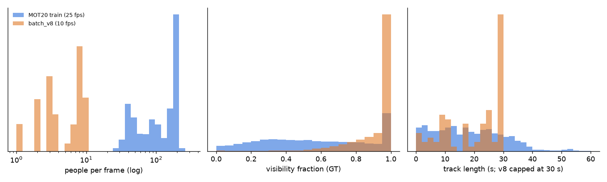

# 73 · Tracking sim-to-real: why association transfers differently from detection

*2026-09-27. Evidence tags: **[V]** measured by us or read from the cited
source this session; **[A]** argued / plausible, not measured. Sources by URL
(fetched 2026-09-27 via WebFetch). Our numbers: `32` §H9/§H17, docs/13 "Box
aspect", `scripts/box_aspect_tracking_stats.py` →
`out/experiments/box_aspect/results.json`.*

## 0 · The argument in five lines

1. A tracking-by-detection tracker is a detector plus an **association** step
   (Kalman motion + IoU, optionally appearance). The detector sees texture; the
   association step mostly sees **geometry and motion**.
2. So the sim-to-real gap of a tracker is not the same gap as the detector's.
   Texture realism (the thing `69`, H13 and H32 measure) drives DetA; the
   *statistics of the scene* — frame rate, camera height/tilt, crowd density,
   occlusion durations, box convention — drive AssA.
3. Our renders differ from MOT20 far more on those statistics than on pixels:
   **5.4 vs 123.5 people/frame, 0.915 vs 0.572 mean visibility, 10 vs 25 fps**
   [V] (§3).
4. Our own experiments agree: synthetic data lifted tracking only through
   detection (H17: DetA +0.034, AssA −0.005 n.s.) [V], and a tracker change that
   looked right on paper did not move either dataset (H9b) [V].
   *[Revised by H24, AUDIT_H24: that is true of synthetic **data**; an appearance **model** in
   ByteTrack stage 1 does raise AssA — MOT20-02 +0.0139, batch_v8 +0.0194 (bar +0.02 not met), fewer
   ID switches, and the GT-box arm (+0.0137) shows it is association, not detection. §3.1.]*
5. Therefore: use synthetic data to train and stress **detectors**, and to
   *unit-test* association logic against perfect truth; tune the tracker's
   motion/occlusion parameters on **real footage from the target site**.

## 1 · Why tracking transfers differently

**What association consumes.** SORT-family trackers (ByteTrack, OC-SORT,
BoT-SORT) predict each track's box with a constant-velocity Kalman filter and
match predictions to detections by IoU (plus, in BoT-SORT/Deep OC-SORT,
appearance cosine distance). Every parameter of that step is kinematic:
process noise, the IoU gate, `max_lost` frames, the low-score threshold. None
of it is sensitive to whether skin shading is photoreal. [A]

**What moves association instead** [A, each tied to evidence below]:

| factor | mechanism | what differs in sim |
|---|---|---|
| Frame rate | displacement per frame vs box width sets whether IoU of prediction and detection is > 0 at all | we render 10 fps; MOT20 is 25 fps; many site NVRs record 5–12 fps |
| Camera height / tilt | steep views compress walking motion in image y and shrink occluder overlap; shallow views create long mutual occlusion | our cameras 3–8 m; MOT20 is high, steep |
| Crowd density | association ambiguity grows with neighbours per gate radius | 5.4 vs 123.5 people per occupied frame |
| Occlusion statistics | how often and how long a track disappears decides whether `max_lost` and re-activation matter | 2.4 % vs 44 % of boxes < 0.5 visible |
| Box convention | IoU-based matching and HOTA's high-α thresholds are sensitive to box extent | MOT20 hand boxes are amodal and ~14 % wider pooled (docs/13) |
| Motion model | pedestrians walk nearly linearly; sim agents follow planner paths with idealised turns | DanceTrack shows non-linear motion breaks Kalman IoU |

**Consequence.** A detector trained on renders can transfer (it learned
"what a person looks like"); a tracker *tuned* on renders learns "how people
move and overlap in *these* scenes", which is the part renders are least
like reality on. [A]

## 2 · What the literature says

**MOTSynth (Fabbri et al., ICCV 2021)** — https://arxiv.org/html/2108.09518 [V]
* Tracktor trained on MOTSynth vs COCO, no fine-tune, MOT17: **45.0 / 51.2 vs
  43.5 / 49.6** MOTA / IDF1 (+1.5 / +1.6). After MOT17 fine-tune, **with the
  same Market ReID in both arms**: MOTSynth 50.3 / 59.8 vs COCO 48.3 / 58.1 —
  MOTSynth wins both (+2.0 / +1.7). *(Audit correction: an earlier draft of
  this file compared MOTSynth **without** ReID, 49.8 / 53.8, to COCO **with**
  Market ReID, 58.1, and called it an IDF1 drop of 4.3 — the exact
  apples-to-oranges error `24` and FACTS already retired.)* Adding a ReID model
  is worth ~+5–6 IDF1 in either arm (53.8 → 59.8), more than the detector's
  training data.
* CenterTrack: MOTSynth 54.3 / 57.7 vs CrowdHuman 52.2 / 53.8 without
  fine-tune; 67.9 / 66.5 after.
* ReID: "identical improvements with both ReID models, trained on MOTSynth and
  Market1501".
* Reading: MOTSynth's gains are small (+1.5–2 MOTA, +1.6–1.7 IDF1) and it
  reports no DetA/AssA split, so it can neither confirm nor refute our H17
  shape (DetA up, AssA flat); what it does show is that the **ReID model, not
  the detector's training data, moves IDF1 most**. MOTSynth is also 768
  sequences of dense GTA crowds, i.e. its *scene statistics* were built to look
  like MOT17; ours were not. (Details and the apples-to-oranges correction: `24`.)

**PersonPath22 (Shuai et al., ECCV 2022)** —
https://amazon-science.github.io/tracking-dataset/personpath22.html [V]
* 236 videos, "over an order of magnitude larger" than MOT17/MOT20, with both
  **amodal and visible boxes** and occlusion tags ("severely occluded person"),
  varying density, weather and time of day.
* Relevance: it is the real dataset whose label design matches ours (amodal +
  visible + visibility), so a box-convention mismatch like MOT20's (§3) can be
  removed rather than argued about. [A: we have not downloaded it.]

**DanceTrack (Sun et al., CVPR 2022)** — https://arxiv.org/abs/2111.14690 [V]
* Uniform appearance, "diverse motion and extreme articulation"; "a
  significant performance drop on DanceTrack when compared against existing
  benchmarks". Trackers built on MOT17 lean on appearance and near-linear
  motion; take either away and they break.

**SportsMOT (Cui et al., ICCV 2023)** — https://arxiv.org/abs/2304.05170 [V]
* 240 sequences, >150 k frames, >1.6 M boxes; "fast and variable-speed motion"
  and "similar yet distinguishable appearance"; "the key challenge … lies in
  object association". Their MixSort fuses motion and appearance.
* Joint reading with DanceTrack: **which cue carries association is a property
  of the scene**, not of the tracker. A defence perimeter at night (uniform
  dark clothing, IR, low fps) is closer to DanceTrack's "appearance useless"
  regime than to MOT17. [A]

**ByteTrack (Zhang et al., ECCV 2022)** — https://arxiv.org/abs/2110.06864 [V]
* Associates low-score boxes to existing tracklets to "recover true objects and
  filter out the background detections"; applied to nine trackers it gave
  "consistent improvement on IDF1 score ranging from 1 to 10 points"; MOT17
  test 80.3 MOTA / 77.3 IDF1 / 63.1 HOTA.
* Why it matters here: BYTE's gain is an *occlusion* gain — low-score boxes are
  mostly partly-occluded people. On a scene with 2.4 % heavily occluded boxes
  (ours) there is little for it to recover. [A]

**OC-SORT (Cao et al., CVPR 2023)** — https://arxiv.org/abs/2203.14360 [V]
* "linear estimates of motion for prolonged time can be highly inaccurate";
  uses observations to build "a virtual trajectory over the occlusion period";
  700+ FPS on one CPU; strong on DanceTrack's non-linear motion.
* Directly relevant to low frame rate and long occlusions behind vehicles (§5).

**BoT-SORT (Aharon et al., 2022)** — https://arxiv.org/abs/2206.14651 [V]
* Motion + appearance + **camera-motion compensation** + a Kalman state with
  width/height instead of aspect; MOT17 80.5 MOTA / 80.2 IDF1 / 65.0 HOTA.
  Against ByteTrack's 80.3 / 77.3 / 63.1: MOTA +0.2, IDF1 +2.9, HOTA +1.9 —
  the additions buy identity, not detection.

**Deep OC-SORT (Maggiolino et al., 2023)** — https://arxiv.org/abs/2302.11813 [V]
* Adaptive weighting of appearance into OC-SORT; MOT20 63.9 HOTA (1st), MOT17
  64.9 (2nd), DanceTrack 61.3. Appearance is weighted *by how discriminative it
  is per detection* — the right shape for sites where appearance is sometimes
  useless (night, IR, uniforms). [A]

**HOTA (Luiten et al., IJCV 2021)** — https://arxiv.org/abs/2009.07736 [V]
* "explicitly balances the effect of performing accurate detection,
  association and localization into a single unified metric"; decomposes into
  sub-metrics for separate error types. HOTA_α = √(DetA_α · AssA_α), averaged
  over α ∈ {0.05, …, 0.95} (19 thresholds). TrackEval
  (https://github.com/JonathonLuiten/TrackEval) is the reference
  implementation; our `survsim/eval/tracking.py` is definition-validated but
  **not yet TrackEval-parity-checked** (M1, `23`).
* Why the definition matters for sim-to-real: the high-α half of HOTA is a
  *box-convention* test. If GT is amodal-and-wide (MOT20) and the detector
  draws visible-and-tight boxes, HOTA drops at high α with no tracking error at
  all. H9 saw the same mechanism on our *own* loose batch_v7 GT (`48` B5):
  disguise cam_sub DetA@0.5 0.83 vs HOTA 0.51 [V]. The MOT20-vs-ours box
  mismatch is inferred from it, not measured on HOTA [A].

## 3 · Our evidence

### 3.1 Experiments [V]

**Pre-parity caveat (2026-09-27).** H9 and H17 were scored with `evaluate_mot` before M1
TrackEval parity (`5571631`; MOT20 subset HOTA 0.4342 → 0.4428 from the scorer change alone).
Their absolute HOTA values are pre-parity and their deltas have **not** been recomputed with the
parity scorer — quote them as "measured with our pre-parity scorer", not as TrackEval numbers.

| result | number | source |
|---|---|---|
| H9a far (median GT < 50 px) − near HOTA, batch_v7 | **−0.171** [−0.251, −0.086], Holm-rejected | `32` §H9 |
| H9a night − day HOTA, 12 paired cameras | −0.006 [−0.053, 0.033], n.s. | `32` §H9 |
| Detection-limited sequences (DetA < AssA) | batch_v7 4/24; MOT20 2/2 | `32` §H9 |
| H9b ByteTrack "fix" (τ 0.6 + gate-before-solve), ΔHOTA | batch_v7 +0.0008 [−0.015, 0.019]; MOT20 +0.0004; **rejected** | `32` §H9 |
| H17 +300 synthetic frames, MOT20-02 HOTA | **+0.0103** [+0.0008, +0.0197], 3/5 seeds positive (unequal-step arms, H26; pre-parity scorer) | `32` §H17 |
| H17 DetA / AssA / ID switches | +0.0342 / −0.0051 (n.s.) / +11 [−0.2, +19.6] | `32` §H17 |

Readings:
* **The failure mode differs.** MOT20 is detection-limited (crowds hide
  people); our renders are association-limited (DetA@0.5 0.80–0.96 on the
  20/24 non-far, non-yard-night sequences; AssA 0.40–0.89 there). Note §3.1 is
  batch_v7 and §3.2 batch_v8 (same scenarios, re-rendered). A tracker fix measured on one says little
  about the other; H9b moved neither.
* **Size, not light, is the sim-side lever** for tracking: far cameras lose
  0.17 HOTA; night alone does not (but hurts where people are already small).
* **Synthetic helps tracking only via detection.** H17's gain is all DetA; the
  extra detections bring extra ID switches (+11, CI [−0.2, +19.6] just spans
  0). MOTSynth has no DetA/AssA split to compare (§2).
* **Correction (H24, AUDIT_H24, 2026-09-27): "only via detection" is about synthetic *data*, not
  about tracking in general.** Adding an appearance *model* (ImageNet OSNet, (1 − IoU) + 1·d_app in
  stage 1, IoU-filtered, TrackEval-scored) raises AssA on real MOT20-02 by **+0.0139 [+0.0018, +0.0268]**
  (IDSW 92.6 → 87.0) and on batch_v8 day by **+0.0194 [+0.0004, +0.0439]** — below the registered
  +0.02 bar, so H24 is not met — and a GT-box arm keeps +0.0137, so the gain is association. H17's
  ID-switch rise is what this fixes. Caveats: 5 checkpoints (MOT20 exact sign-flip p 0.19), one real
  sequence, w = 1 untuned, no night arm. **H46 (2026-09-27):** sweeping w ∈ {0.25,0.5,1,2,4} finds
  ΔAssA rising monotonically with w on both sets, same argmax w = 4 (batch_v8 +0.0421
  [+0.0083,+0.0819], MOT20-02 +0.0338 [+0.0157,+0.0520]) — post-hoc sweep, not Holm-significant
  across the 5 w values, cross-set validation pending in H46b (AUDIT_H46) — w = 1 was not the
  optimum tried, and the sweep did not find a ceiling. The night arm this section flagged now exists and does **not**
  support "appearance still helps, just less": batch_v8 night (2 seqs, 1 checkpoint, budget-bounded)
  at w = 4 gives ΔAssA −0.0147 [−0.0972,+0.0535] — CI spans 0, mean negative. Treat appearance
  association as a day-only recommendation until a wider night run (more sequences/checkpoints)
  either confirms or overturns this. Details: `32` §H46.
  **H46b (2026-09-27):** extending w to {8,16,32} plus a true appearance-only cost arm finds an
  interior AssA ceiling on both sets (day argmax w=16 +0.0613, MOT20-02 argmax w=8 +0.0486), but
  ID switches rise with w throughout on MOT20-02 (up to +69.2 at w=32) and explode under
  appearance-only (+162.0 MOT20-02) — the ceiling is priced in IDSW, not free. Cross-validating w*
  between the two sets clears the +0.02 bar in both directions. The wider night run this section
  asked for now exists (6 sequences × 5 checkpoints, up from 2×1): ΔAssA +0.0470
  [−0.0046,+0.1337] at w=16 — positive, reversing H46's negative point estimate, but the CI still
  touches 0. Read as "appearance most likely still helps at night", not yet confirmed at the
  pre-registered bar. Details: `32` §H46b.
  **Reference-tracker recommendation (H46b, cross-validated, 2026-09-27):** ByteTrack +
  OSNet-ImageNet appearance at **w ≈ 8** (cross-validated; **+0.05 AssA held-out** — the
  MOT20-02-chosen w = 8 gives day held-out ΔAssA +0.0570 [+0.0208,+0.0987], the day-chosen w = 16
  gives MOT20-02 held-out ΔAssA +0.0479 [+0.0328,+0.0629]; w = 8 is the safer of the two under an
  IDSW budget), **with the IDSW cost stated** — day ΔIDSW at w = 8 is −1.62 [−3.48,+0.02]
  (favourable), MOT20-02 ΔIDSW at w = 8 is +15.80 [+6.00,+26.80] (a real cost, worse at w = 16/32);
  **never appearance-only** — `app_only` drops the geometry term and produces ΔIDSW +13.4 day /
  **+162.0 MOT20-02** and ΔDetA −0.0109 [−0.0225,−0.0004], the worst arm in the whole sweep.

### 3.2 Scene statistics: batch_v8 vs MOT20 [V]

Computed from GT (`scripts/box_aspect_tracking_stats.py`). MOT20: train
01/02/03/05, conf = 1, class = 1, visibility from the GT file. batch_v8: four
unique-geometry day sets (disguise, smoke_mock, street_crowd, street_crowd_far
without its duplicate cam_01), **11 cameras** × 300 frames, **amodal GT** with the mask-derived
visibility fraction (`survsim/gt/amodal.py`).

| statistic | MOT20 train | batch_v8 | ratio |
|---|---|---|---|
| frame rate | 25 fps | 10 fps | 2.5× |
| people per frame, mean (p90), frames with ≥ 1 person | **123.5** (197) | **5.4** (9) | 23× |
| people per rendered frame (incl. 202 empty of 3,300) | ≈ 123.5 | 5.05 | 24× |
| mean GT visibility | **0.572** | **0.915** | — |
| boxes < 0.5 visible | 44 % | 2.4 % | 18× |
| median box height | 140 px | 51 px | 0.36× |
| tracks | 2,208 | 83 | — |
| median track length | 17.7 s | 23.0 s (capped at 30 s) | — |
| p90 track length | 35.3 s | 29.9 s (cap) | — |
| fragment gaps per track (track absent then back) | 0.60 | 0.05 | 12× |
| box w/h, MOT20 ÷ v8 mask, pooled ≥ 50 px | 1.138 [1.062, 1.213] | — | docs/13 |

*Figure: people per frame (log), GT visibility, track length. batch_v8's
track-length spike at 30 s is the 300-frame render window, not behaviour.*

Box aspect by height (`figures/fig_box_aspect.png`, docs/13 "Box aspect"):
+22 % at 50–100 px, n.s. at 100–200 px, +12 % [−1, +26] at ≥ 200 px.

**What the table says.** batch_v8 is a sparse, mostly-unoccluded, short-window,
low-frame-rate world with small people; MOT20 is a dense, half-occluded,
high-frame-rate world with large people. Only the *frame rate* and *size*
columns resemble a defence perimeter; density and occlusion resemble neither a
perimeter (sparser still) nor MOT20. Consequences [A]:
* Tracker hyper-parameters tuned on batch_v8 will under-weight occlusion
  handling (BYTE's low-score pass, OC-SORT's re-update have little to do).
* A 30 s window cannot test re-acquisition after a 20 s disappearance behind a
  vehicle — the case §5 cares about. Longer renders are cheap in the mock
  backend and needed for that test.
* 0.05 gaps/track means ID-switch statistics on our renders come from crossings,
  not from re-entry; MOT20's come from both.

## 4 · What to do with synthetic data for tracking

1. **Truth for association unit tests** [V-capable]: perfect IDs, amodal boxes
   and visibility let us score *association alone* by feeding GT boxes with
   controlled noise and drop-outs. This isolates AssA from DetA, which no real
   dataset can do cleanly.
2. **Parameter sweeps over scene statistics** [A]: the value of a simulator is
   that fps, camera height/tilt, density and occlusion duration are dials.
   Sweep them and report tracker degradation *curves*, not a single number.
3. **Do not tune on renders and ship** [A]: final Kalman noise, `max_lost`, IoU
   gate and appearance weight should be set on footage from the target site
   (a few annotated hours), because §3.2 shows the renders sit outside the real
   distribution on exactly those axes.
4. **Match box conventions before comparing HOTA across domains** [V]: MOT20
   is amodal and wider; score our trackers against our amodal GT when comparing
   to MOT20 numbers, visible GT when the downstream use is pixel crops.

## 5 · What a defence-site tracker should do [A]

* **Low frame rate.** Sites record 5–12 fps to save storage. At 5 fps a walker
  moves ~0.28 m/frame — at 50 px tall (~29 px/m for a 1.75 m person) that is
  ~8 px, ~40 % of a ~19 px wide box (w/h 0.38), so IoU of prediction vs detection is small. Use centre-distance or
  ground-plane Mahalanobis gating, not IoU alone; OC-SORT-style observation
  re-update.
* **Long occlusions behind vehicles.** A person behind a parked van for 10–30 s
  must re-attach, not spawn a new ID. Keep lost tracks in world coordinates for
  tens of seconds with a growing position uncertainty; re-attach by gated
  ground-plane distance + appearance where appearance is informative
  (Deep OC-SORT-style adaptive weight; near zero at night/IR).
* **PTZ hand-off.** A slewing PTZ breaks image-space motion models; BoT-SORT's
  camera-motion compensation or, better, the known pan/tilt from the head's
  telemetry. Our camera director already knows the live pose (principle 2), so
  the simulator can test hand-off with truth.
* **World-coordinate tracking.** With a calibrated ground plane, track feet
  positions in metres: velocity priors become physical (1.4 m/s walk), gating
  is scale-invariant across near/far cameras, and multi-camera association
  becomes geometric. Calibration error dominates: 1° pitch at 30 m from a 4 m
  mount ≈ 3.9 m of ground error (`00` fact 4) — validate calibration before
  trusting the gate. **Gates must widen with range** (H39, 32 §H39, 75 §3–4): even
  the exact calibration leaves 0.21 m (box bottom ≠ foot), and a post-hoc
  datasheet-f auto-calibration gave 0.96 m within 20 m but 2.9 m beyond 30 m, so a
  fixed 0.5 m gate fragments every far track; elongate gates along the viewing
  ray. A free-f pedestrian auto-calibration (57 m) is unusable for gating.
* **Track-quality gating before alarms.** An alarm on a loiter rule should
  require a track that is long enough, mostly confirmed (not coasting), and has
  not just switched ID. Our alarm scoring is actor-aware (principle 4): an
  alarm on the wrong uid is a false alarm, so ID switches cost directly in
  FA/camera-hour. Expose track confidence to the rule, and measure the FA/h
  saved against recall lost (`58`, H22).

## 6 · H24 refined design (reference only; not implemented here)
*Status 2026-09-27: run and audited (32 §H24, AUDIT_H24). Adopted: street_crowd_day reported
separately (+0.0267), GT-box arm (+0.0137), IDSW secondary. Not run: the night arm — now H46 (66).*

H24 (`66` §H24): does OSNet appearance in ByteTrack association raise AssA on
batch_v8 by ≥ 0.02 without lowering it on MOT20-02? It **needs M1 TrackEval
parity** first (in progress by another agent; `23` M1). Refinements suggested
by this report [A]:
* Report AssA on **batch_v8 street_crowd (densest)** separately; sparse sets
  have almost no association ambiguity for ReID to fix (0.05 gaps/track).
* Add a **GT-box arm** (GT boxes + noise, no detector) so the AssA effect is
  not confounded with DetA — the H17 lesson.
* Add a **night arm**: appearance should help less there; Deep OC-SORT-style
  adaptive weighting is the arm that should not lose.
* Pre-register the ID-switch count as a secondary: H17's +11 is what H24 is
  meant to fix.

## 7 · Interview Q&As (10)

**Q1. "Your synthetic data improved the detector. Does it improve tracking?"**
Only through detection. H17 (unequal-step arms, H26): HOTA +0.0103 [+0.0008, +0.0197], all of it DetA
(+0.034); AssA −0.005 n.s.; ID switches +11; only 3/5 seeds positive. MOTSynth
reports no DetA/AssA split; like for like it gains +1.7 IDF1, and its table
says the ReID model moves IDF1 more than synthetic data does (don't quote its
53.8 vs 58.1 (retired comparison) — that pits no-ReID against ReID). *Red flag:* "HOTA went up,
so tracking transfers."

**Q2. "Why would tracking transfer differently from detection?"**
Association consumes geometry and motion — fps, camera height, density,
occlusion — not texture. Our renders are 5.4 people/frame at 0.92 visibility
vs MOT20's 123.5 at 0.57 (and 10 vs 25 fps); the association problem is different even if pixels
were perfect. *Red flag:* talking only about photorealism.

**Q3. "What limits HOTA on your renders vs on MOT20?"**
Different things: MOT20 is detection-limited (DetA < AssA on 2/2); 20/24 of our
batch_v7 sequences are association-limited. Far cameras cost −0.171 HOTA; night
alone is n.s. *Red flag:* one explanation for both.

**Q4. "You tried a ByteTrack fix. What happened?"**
τ 0.6 + gate-before-solve: ΔHOTA +0.0008 [−0.015, 0.019] on batch_v7, +0.0004
on MOT20; the gate alone was worse on both. Rejected by the pre-registered rule
and left behind a flag. *Red flag:* adopting it because it "should" help.

**Q5. "Define HOTA and say what the high-α half measures."**
√(DetA·AssA) at each of 19 IoU thresholds, averaged. High α tests localisation
and box convention: amodal-wide GT vs tight predictions loses there with zero
tracking error (H9, our own loose v7 GT on cam_sub: DetA@0.5 0.83, HOTA 0.51). *Red flag:* HOTA =
"MOTA but better".

**Q6. "Are your boxes like MOT20's?"**
No: MOT20 w/h is 14 % [6, 21] wider pooled, +22 % at 50–100 px, n.s. at
100–200 px — and MOT20 is amodal and clipped at the border, which I had to
filter out (its "< 50 px" boxes are edge truncations). I replaced a docs claim
that had no data behind it. *Red flag:* one number without a height bin.

**Q7. "Design a tracker for a perimeter recorded at 6 fps."**
Ground-plane tracking on calibrated cameras, Mahalanobis gating in metres,
OC-SORT-style re-update, lost tracks held 30 s in world coordinates,
appearance weighted by informativeness, PTZ pose from telemetry, track-quality
gate before alarms. *Red flag:* "ByteTrack with default settings".

**Q8. "When is ReID worth adding to the tracker?"**
When appearance is discriminative and occlusions are long: BoT-SORT's
additions (ReID + camera-motion compensation + KF state, not separated in the
abstract) buy IDF1 +2.9, MOTA +0.2 over ByteTrack on MOT17 test. DanceTrack shows appearance
can be useless; at night/IR it often is. Measure it (H24) on the site's density;
don't assume. *Red flag:* ReID always on.

**Q9. "How would you use the simulator for tracking, then?"**
As a truth oracle and a dial: score association on GT boxes with injected
noise, sweep fps/tilt/density/occlusion duration, and get degradation curves;
tune final parameters on annotated site footage. *Red flag:* "train the tracker
on synthetic".

**Q10. "How do ID switches affect operations?"**
Our alarm scoring is actor-aware — an alarm on the wrong identity is a false
alarm, not a hit — so ID switches flow straight into FA/camera-hour, and a
switch mid-loiter resets dwell timers (missed alarm). That is why track-quality
gating precedes alarms. *Red flag:* treating IDF1 as a leaderboard number
unrelated to alarms.

## 8 · Caveats

* batch_v8 statistics are 11 cameras, 83 tracks, a 30 s window; MOT20 is four
  sequences from few sites. Neither is a defence perimeter.
* The box-aspect comparison mixes view geometry and label convention; it
  cannot separate them.
* Literature numbers are from abstracts / the MOTSynth HTML Table 6 re-fetched
  on 2026-09-27 (AUDIT_70_73); PersonPath22 and SportsMOT were not downloaded or run.
* §5 is design argument [A], not a measured result.
